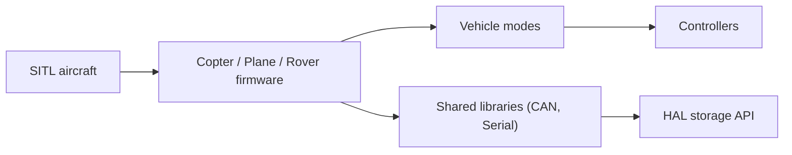

# ArduPilot/ardupilot

> Open-source autopilot software for drones, planes, rovers, boats and submarines.

## The problem
Piloting autonomous vehicles without proprietary flight software.

## What it actually does
One firmware per vehicle type (Copter, Plane, Rover, Sub, Blimp, Antenna Tracker) with flight modes, controllers, navigation EKF, MAVLink, shared libraries (CAN, serial, storage) and SITL simulation. Maintained since 2010.

## How it is wired

## Trying it
No command in the README; the guides are on the developer wiki.

## Cost and gotchas
Free; hardware (flight controller, sensors) and a cross-compilation toolchain required. Links between subsystems not verified in the code read.

## What it is not
Not desktop or AI software: it is real-time firmware. The README's "most advanced" claim is not repeated.

## Alternatives
No alternative named in the README.

## For you
Ignore: embedded robotics with no direct link to your work; useful only for an autonomous drone project.
