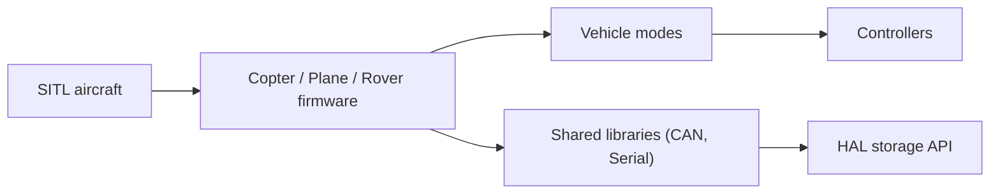

# ArduPilot/ardupilot

> Logiciel de pilote automatique libre pour drones, avions, rovers, bateaux et sous-marins.

## Le problème
Piloter des véhicules autonomes sans logiciel de vol propriétaire.

## Ce que ça fait vraiment
Un micrologiciel par type de véhicule (Copter, Plane, Rover, Sub, Blimp, Antenna Tracker) avec modes de vol, contrôleurs, EKF de navigation, MAVLink, bibliothèques partagées (CAN, série, stockage) et simulation SITL. Maintenu depuis 2010.

## Comment c'est branché

## Essayer
Aucune commande dans le README ; les guides sont sur le wiki du développeur.

## Coût et pièges
Gratuit ; matériel (carte de vol, capteurs) et chaîne de compilation croisée requis. Liens entre sous-systèmes non vérifiés dans le code lu.

## Ce que ce n'est pas
Pas un logiciel de bureau ni d'IA : c'est du firmware temps réel. La mention « le plus avancé » du README n'est pas reprise.

## Alternatives
Aucune alternative nommée dans le README.

## Pour toi
À ignorer : robotique embarquée sans lien direct avec ton métier ; utile seulement pour un projet de drone autonome.

