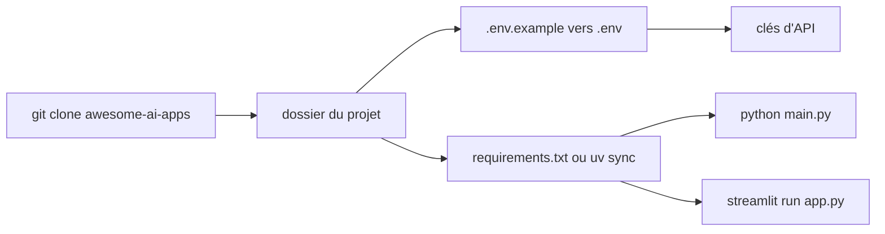

# Arindam200/awesome-ai-apps

> Collection of 132 example projects covering agents, RAG, voice, MCP and fine-tuning.

## The problem
Choosing between LangGraph, CrewAI, Agno, Mastra, ADK or Semantic Kernel without writing
the same agent six times to compare.

## What it actually does
Sorts 132 runnable projects into seven families: 21 "starter agents" (one per
framework — AutoGen, AWS Strands, CAMEL, CrewAI, DSPy, Google ADK, smolagents,
LangChain, LangGraph, Letta, LlamaIndex, Mastra, Microsoft Agent Framework, OpenAI
Agents SDK, PydanticAI, Semantic Kernel), 18 simple agents, 9 voice agents
(LiveKit, Pipecat, Deepgram), 14 MCP agents, 13 agents with memory (Memori, Agno), 18
RAG applications (Neo4j GraphRAG, PDF RAG with Qdrant reranking, typed LlamaIndex
RAG, trustworthy RAG with citation verification), 34 advanced multi-agent
agents, and 6 end-to-end fine-tuning examples.

## How it is wired


## Trying it
```bash
git clone https://github.com/Arindam200/awesome-ai-apps.git
cd starter_ai_agents/agno_starter
cp .env.example .env
uv sync
streamlit run app.py
```

## Cost and gotchas
The repository is free, but almost every project requires API keys, and a
large part is explicitly "powered by Nebius Token Factory" — the sponsor
shows through in the implementation choices. Python 3.10+, 3.11+ recommended for
recent projects.

## What it is not
Not a library: nothing to install, nothing to import. No guarantee that all
132 projects still run — it is a showcase, not a tested suite. The
descriptions come from the maintainer.

## Alternatives
- No alternative repository named in the README.

## For you
A good catalog to browse to spot an implementation pattern (PDF RAG with
reranking, RAG with verified citations), provided you filter out the sponsored
examples.
