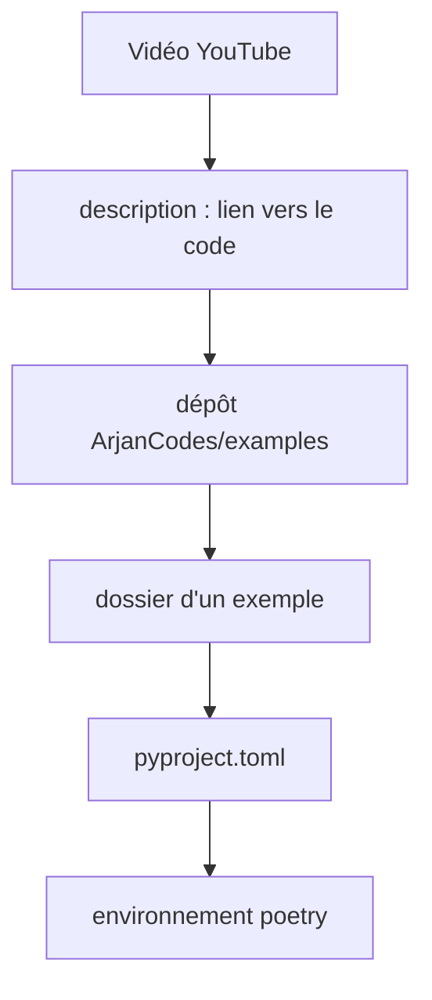

# ArjanCodes/examples

> The code examples from ArjanCodes' YouTube videos, one Python project per example.

## The problem
Following a software design video without the code at hand forces you to retype everything.

## What it actually does
Companion code repository: the main branch contains the code of the latest video. Each example has at least a pyproject.toml to create a virtual environment with poetry. The README does not detail the topics covered.

## How it is wired

Simplified diagram based on the sheet, no diagram provided.

## Trying it
```bash
git clone https://github.com/arjancodes/examples.git
cd examples
```

## Cost and gotchas
Free. You have to install dependencies example by example; Python and poetry are assumed. The examples are tied to videos; out of context they read poorly.

## What it is not
Not a library nor a structured course. No guarantee of consistency between examples.

## Alternatives
No alternative named in the README.

## For you
Worth watching: useful if you follow the channel for Python design best practices, otherwise of little interest outside the videos.
