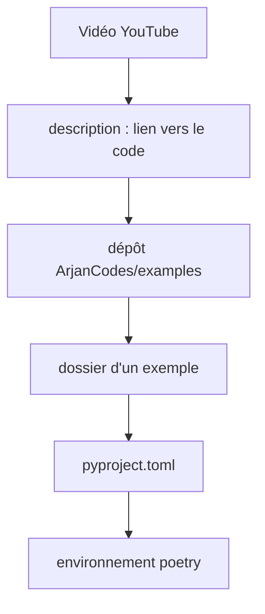

# ArjanCodes/examples

> Les exemples de code des vidéos YouTube d'ArjanCodes, un projet Python par exemple.

## Le problème
Suivre une vidéo de conception logicielle sans le code sous la main oblige à tout retaper.

## Ce que ça fait vraiment
Dépôt de code compagnon : la branche main contient le code de la dernière vidéo. Chaque exemple a au moins un pyproject.toml pour créer un environnement virtuel avec poetry. Le README ne détaille pas les sujets couverts.

## Comment c'est branché

Schéma simplifié d'après la fiche, sans diagramme fourni.

## Essayer
```bash
git clone https://github.com/arjancodes/examples.git
cd examples
```

## Coût et pièges
Gratuit. Il faut installer les dépendances exemple par exemple ; Python et poetry sont supposés. Les exemples sont liés à des vidéos, hors contexte ils se lisent mal.

## Ce que ce n'est pas
Pas une bibliothèque ni un cours structuré. Pas de garantie de cohérence entre exemples.

## Alternatives
Aucune alternative nommée dans le README.

## Pour toi
À surveiller : utile si tu suis la chaîne pour des bonnes pratiques de conception en Python, sinon peu d'intérêt hors vidéo.

