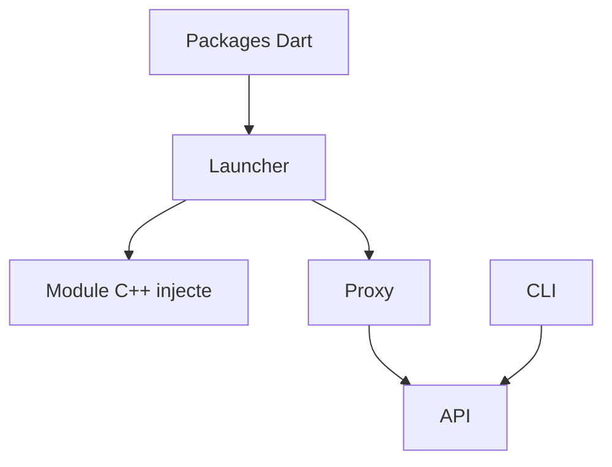

# ArmchairDevelopers/Kyber

> Open source private server tool for the game Star Wars Battlefront II (2017), for players.

## The problem
Not documented: the README does not describe the problem, only the repository.

## What it actually does
A monorepo: a C++ module injected into the game client, a launcher, a server proxy, an API service, command-line tools and shared Dart packages. Operating details are in BUILDING.md, not provided here.

## How it is wired
Simplified diagram based on the sheet, no diagram provided.

## Trying it
No command documented in this README: see BUILDING.md.

## Cost and gotchas
Free (GPL-3.0). You need to own the game. Free Windows code signing via SignPath. Every change is reviewed by another member before merging.

## What it is not
Not a work tool nor a security tool. It is a gaming tool that modifies the client, which may go against the publisher's terms.

## Alternatives
No alternative named in the README.

## For you
Ignore: a video game with no link to your data / AI work.
