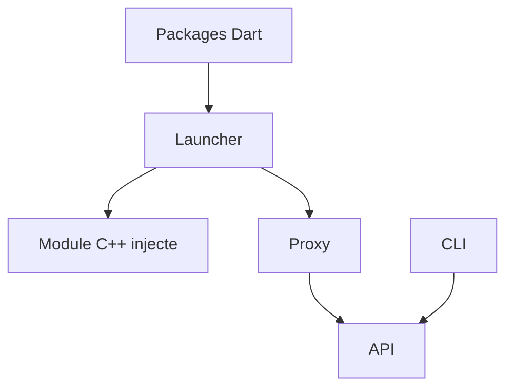

# ArmchairDevelopers/Kyber

> Outil open source de serveurs privés pour le jeu Star Wars Battlefront II (2017), pour les joueurs.

## Le problème
Non documenté : le README ne décrit pas le problème, seulement le dépôt.

## Ce que ça fait vraiment
Un monorepo : un module C++ injecté dans le client du jeu, un lanceur, un proxy de serveur, un service d'API, des outils en ligne de commande et des paquets Dart partagés. Les détails de fonctionnement sont dans BUILDING.md, non fourni ici.

## Comment c'est branché
Schéma simplifié d'après la fiche, sans diagramme fourni.

## Essayer
Aucune commande documentée dans ce README : voir BUILDING.md.

## Coût et pièges
Gratuit (GPL-3.0). Il faut posséder le jeu. Signature de code Windows gratuite via SignPath. Chaque changement est relu par un autre membre avant fusion.

## Ce que ce n'est pas
Pas un outil de travail ni un outil de sécurité. C'est un outil de jeu qui modifie le client, ce qui peut aller à l'encontre des conditions de l'éditeur.

## Alternatives
Aucune alternative nommée dans le README.

## Pour toi
À ignorer : jeu vidéo sans lien avec ton métier de data / IA.

