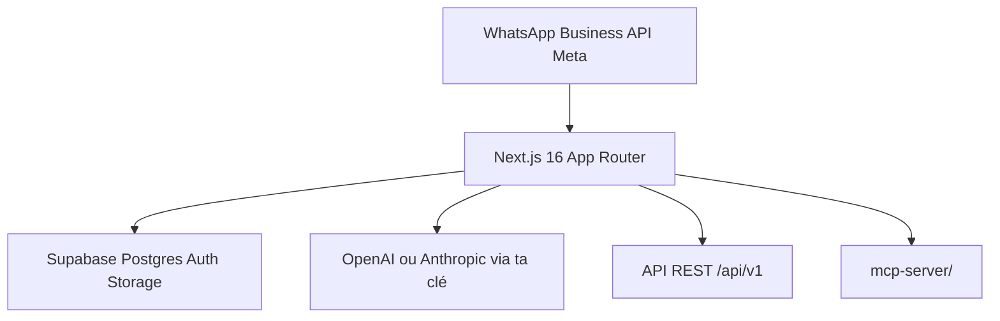

# ArnasDon/wacrm

> Self-hostable WhatsApp CRM template to fork: shared inbox, pipelines, broadcasts, automations.

## The problem
WhatsApp CRMs are SaaS products billed per seat; here you want to own the code and the data.

## What it actually does
Shared inbox on the official WhatsApp Business API, contacts and tags, Kanban pipelines, broadcasts with Meta-approved templates and visual automations. AI reply assistant with your OpenAI or Anthropic key, knowledge base (Postgres full-text search or pgvector). Public REST API and MCP server, read-only by default.

## How it is wired
Simplified diagram based on the fiche, no diagram provided.



## Trying it
```bash
git clone https://github.com/<your-username>/wacrm.git
cd wacrm
npm install
cp .env.local.example .env.local
npm run dev
```

## Cost and gotchas
Supabase account, Meta Cloud API access, AI keys at your expense, hosting (Hostinger recommended, not required). HTTPS webhook required.

## What it is not
It is not a finished product but a template to fork. Not a framework or an SDK. The documentation site is in another repository.

## Alternatives
No alternative named in the README.

## For you
Ignore: a WhatsApp CRM is outside the data/MLOps scope; only the "pgvector RAG + MCP" pattern may inspire.
