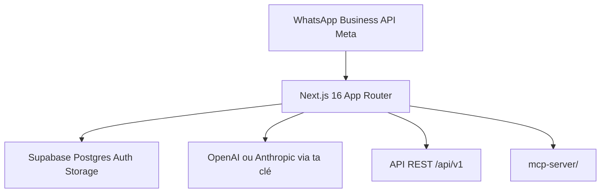

# ArnasDon/wacrm

> Modèle de CRM WhatsApp auto-hébergeable à forker : boîte partagée, pipelines, diffusions, automatisations.

## Le problème
Les CRM WhatsApp sont des SaaS à la place facturée ; ici on veut posséder le code et les données.

## Ce que ça fait vraiment
Boîte de réception partagée sur l'API WhatsApp Business officielle, contacts et tags, pipelines Kanban, diffusions avec modèles approuvés par Meta et automatisations visuelles. Assistant de réponse IA avec ta clé OpenAI ou Anthropic, base de connaissances (recherche plein texte Postgres ou pgvector). API REST publique et serveur MCP en lecture seule par défaut.

## Comment c'est branché
Schéma simplifié d'après la fiche, sans diagramme fourni.



## Essayer
```bash
git clone https://github.com/<your-username>/wacrm.git
cd wacrm
npm install
cp .env.local.example .env.local
npm run dev
```

## Coût et pièges
Compte Supabase, accès Meta Cloud API, clés IA à ta charge, hébergement (Hostinger recommandé, pas obligatoire). Webhook en HTTPS requis.

## Ce que ce n'est pas
Ce n'est pas un produit fini mais un modèle à forker. Pas un framework ni un SDK. Le site de documentation est dans un autre dépôt.

## Alternatives
Aucune alternative nommée dans le README.

## Pour toi
À ignorer : un CRM WhatsApp est hors périmètre data/MLOps ; seul le patron « RAG pgvector + MCP » peut inspirer.

