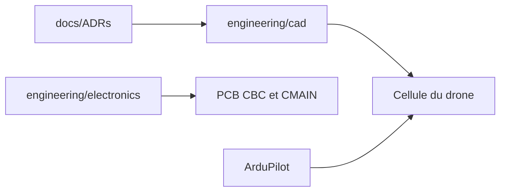

# Arrow-air/project-caribou

> Open design of a 200 kg hexacopter for freight and precision agriculture.

## The problem
Delivering freight or spraying crops with a heavy drone is expensive and hard to repair in the field.

## What it actually does
Hardware design repository: CAD in build123d, KiCad boards (battery, main board), architecture decision records and meeting notes. Announces about 100 kg of payload, 18 to 24S, ArduPilot, IMU, GPS and compass redundancy, and removable arms.

## How it is wired

## Trying it
No documented command.

## Cost and gotchas
Heavy, high-voltage hardware (60 to 100 V): real cost and safety concerns. No bill of materials or assembly instructions in the README.

## What it is not
Not a drone ready to build: it is a design work in progress (created in 2026).

## Alternatives
Project Feather and Project Quiver, cited as predecessors.

## For you
Ignore: drone hardware design, unrelated to data / AI / MLOps.
