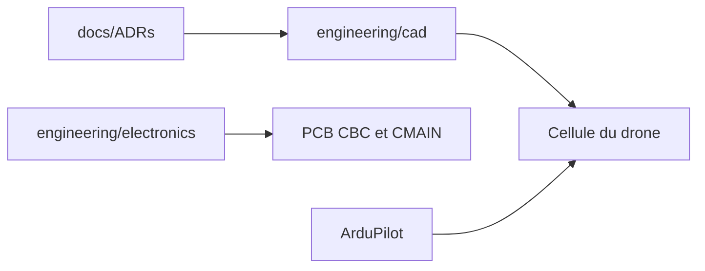

# Arrow-air/project-caribou

> Conception libre d'un hexacoptère de 200 kg pour le fret et l'agriculture de précision.

## Le problème
Livrer du fret ou pulvériser des cultures avec un drone lourd coûte cher et se répare mal sur le terrain.

## Ce que ça fait vraiment
Dépôt de conception matérielle : CAD en build123d, cartes KiCad (batterie, carte principale), notes de décisions d'architecture et réunions. Annonce environ 100 kg de charge utile, 18 à 24S, ArduPilot, redondance IMU, GPS et compas, et bras démontables.

## Comment c'est branché

## Essayer
Aucune commande documentée.

## Coût et pièges
Matériel lourd et haute tension (60 à 100 V) : coût et sécurité réels. Aucune nomenclature ni instruction de montage dans le README.

## Ce que ce n'est pas
Pas un drone prêt à construire : c'est un travail de conception en cours (créé en 2026).

## Alternatives
Project Feather et Project Quiver, cités comme prédécesseurs.

## Pour toi
À ignorer : conception matérielle de drone, sans lien avec data / IA / MLOps.

