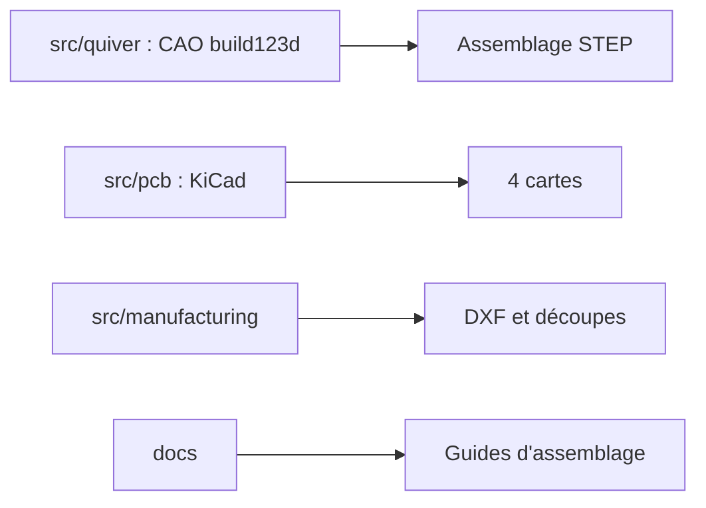

# Arrow-air/project-quiver

> Open plans for a modular 25 kg quadcopter, for drone developers and operators.

## The problem
Payload drones are closed, hard to repair and hard to adapt.

## What it actually does
Publishes the design: CAD assembly in Python (build123d), four KiCad boards, 3D-printing profiles, cutting files, flight logs. 5 to 8 kg payload, three quick-swap interfaces, dual RTK GNSS, ArduPilot firmware, 25 to 31 minutes of hover time.

## How it is wired

## Trying it
No command in the README: see the assembly guides in `docs/`.

## Cost and gotchas
Hardware to buy and assemble yourself (battery, propulsion). Development kit loans go through Discord. Hardware license CERN-OHL-S-2.0, strong copyleft.

## What it is not
It is not software to install: it is a hardware project. It is not a ready-to-fly drone.

## Alternatives
No alternative named in the README.

## For you
Ignore: a hardware drone project outside your data / AI / MLOps scope, unless you are interested in robotics.
