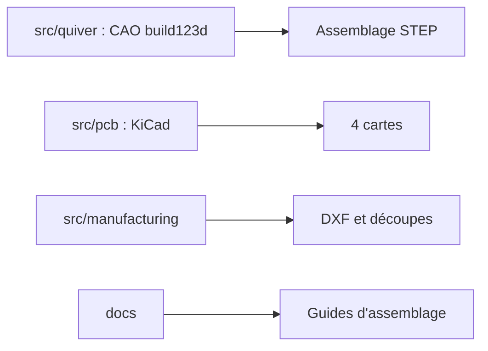

# Arrow-air/project-quiver

> Plans ouverts d'un quadricoptère modulaire de 25 kg, pour développeurs et opérateurs de drones.

## Le problème
Les drones de charge utile sont fermés, difficiles à réparer et à adapter.

## Ce que ça fait vraiment
Publie la conception : assemblage CAO en Python (build123d), quatre cartes KiCad, profils d'impression 3D, fichiers de découpe, journaux de vol. Charge de 5 à 8 kg, trois interfaces rapides, double GNSS RTK, firmware ArduPilot, 25 à 31 minutes de vol stationnaire.

## Comment c'est branché

## Essayer
Aucune commande dans le README : voir les guides d'assemblage dans `docs/`.

## Coût et pièges
Matériel à acheter et assembler soi-même (batterie, propulsion). Les prêts de kit de développement passent par le Discord. Licence matérielle CERN-OHL-S-2.0, copyleft fort.

## Ce que ce n'est pas
Ce n'est pas un logiciel à installer : c'est un projet matériel. Ce n'est pas un drone prêt à voler.

## Alternatives
Aucune alternative nommée dans le README.

## Pour toi
À ignorer : projet de drone matériel hors de ton périmètre data / IA / MLOps, sauf intérêt pour la robotique.

