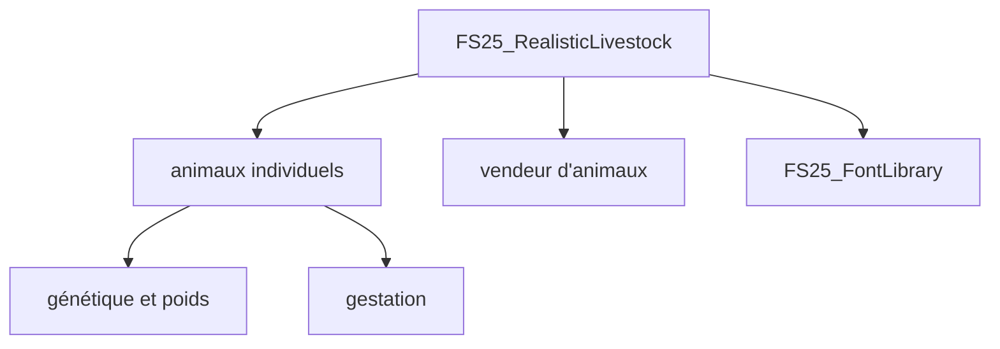

# Arrow-kb/FS25_RealisticLivestock

> Farming Simulator 25 mod that makes every animal an individual (genetics, weight, pregnancy, aging).

## The problem
In the base game, animals are interchangeable clusters, with no history or variety.

## What it actually does
Each animal has an identifier, a birth date, genes (health, fertility, metabolism...) and a weight. Improved pregnancy, production tied to condition, possible death, animal dealer reworked per country. Requires FS25_FontLibrary.

## How it is wired
Simplified diagram based on the sheet, no diagram provided.

## Trying it
No command documented in the README.

## Cost and gotchas
Free. You need to own the game. The author announces the end of development and withdrawal from the ModHub; 146 open issues.

## What it is not
Not maintained: a private version was uploaded, and others are free to take it over with credit. No male models.

## Alternatives
Not documented in the README.

## For you
Ignore: abandoned game mod, unrelated to data, AI or MLOps work.
