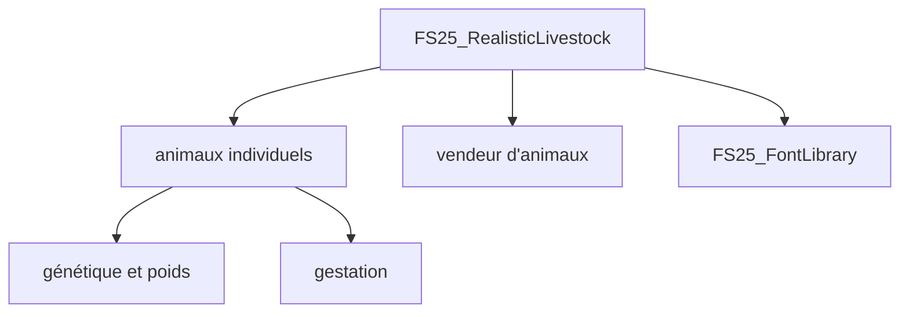

# Arrow-kb/FS25_RealisticLivestock

> Mod pour Farming Simulator 25 qui rend chaque animal individuel (génétique, poids, gestation, vieillissement).

## Le problème
Dans le jeu de base, les animaux sont des grappes interchangeables, sans histoire ni variété.

## Ce que ça fait vraiment
Chaque animal a un identifiant, une date de naissance, des gènes (santé, fertilité, métabolisme…) et un poids. Gestation améliorée, production liée à l'état, mort possible, vendeur d'animaux refondu par pays. Requiert FS25_FontLibrary.

## Comment c'est branché
Schéma simplifié d'après la fiche, sans diagramme fourni.

## Essayer
Aucune commande documentée dans le README.

## Coût et pièges
Gratuit. Il faut posséder le jeu. L'auteur annonce l'arrêt du développement et le retrait du ModHub ; 146 issues ouvertes.

## Ce que ce n'est pas
Pas maintenu : version privée déposée, reprise libre par d'autres avec crédit. Pas de modèles de mâles.

## Alternatives
Non documenté dans le README.

## Pour toi
À ignorer : mod de jeu abandonné, sans lien avec un travail data, IA ou MLOps.

