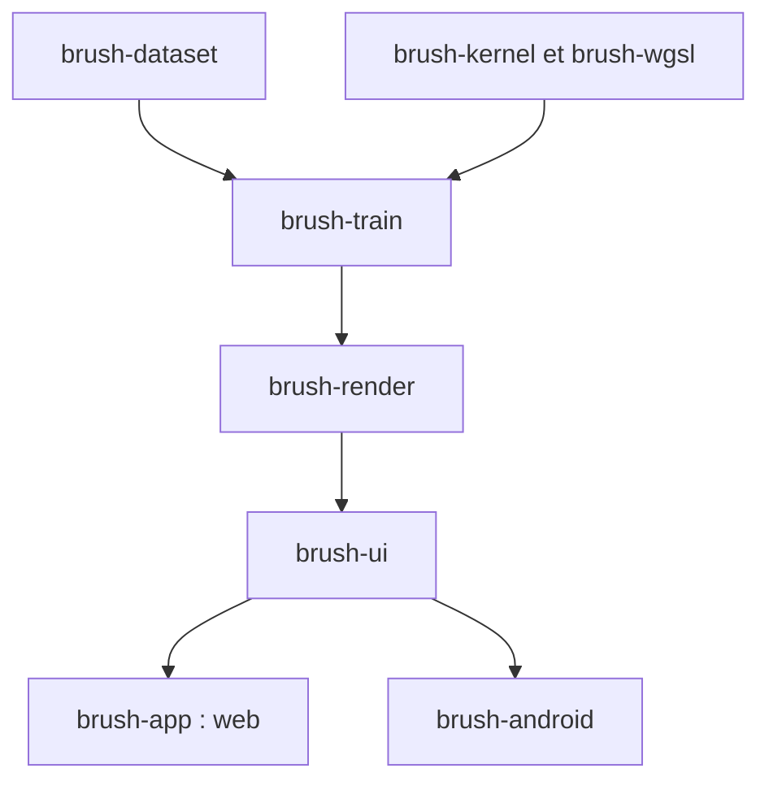

# ArthurBrussee/brush

> 3D reconstruction engine using Gaussian splatting, cross-platform and with no CUDA dependency.

## The problem
Learning-based rendering tools demand CUDA and heavy dependencies, and rarely run everywhere.

## What it actually does
Brush trains 3D scenes from COLMAP or Nerfstudio data, with masks and transparent images. It visualizes splats live (.ply, .compressed.ply files, animated archives). It runs on macOS, Windows, Linux, Android and in the browser thanks to WebGPU and the Burn framework. A command line and a rerun integration are provided.

## How it is wired


## Trying it
```bash
cargo run --release
cargo test --all
brush --help
cargo bench
```

## Cost and gotchas
Free. Rust 1.88 or later; a WebGPU-compatible graphics card (AMD, Nvidia, Intel). The web demo only works on Chrome and Edge (Chrome 134+ on Windows and macOS). Android requires the SDK and NDK.

## What it is not
It is not an official Google product: the README states this, while noting that it is a repository derived from a research repository. It is not a full photogrammetry suite: it needs camera poses (COLMAP).

## Alternatives
gsplat is cited: Brush claims to be faster at rendering and training, but gsplat remains the reference under CUDA.

## For you
Keep an eye on it: relevant for Gaussian splatting without CUDA, useful if your work touches 3D vision.
