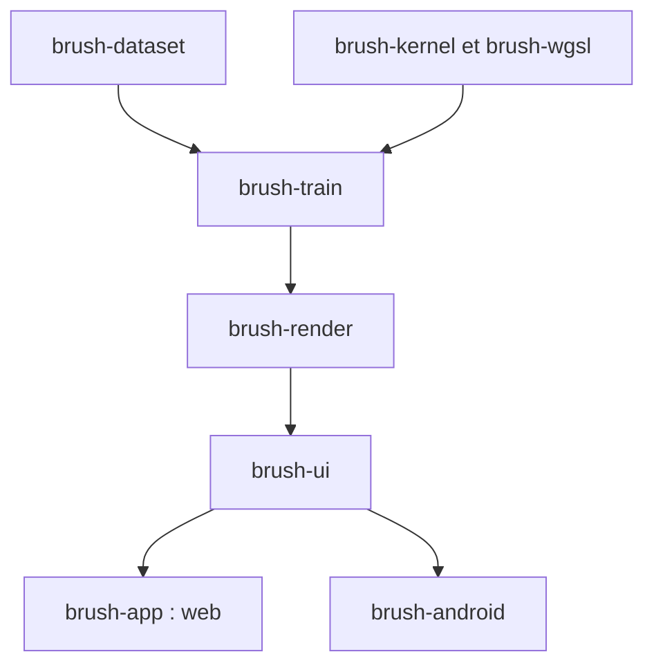

# ArthurBrussee/brush

> Moteur de reconstruction 3D par Gaussian splatting, multiplateforme et sans dépendance CUDA.

## Le problème
Les outils de rendu par apprentissage exigent CUDA et des dépendances lourdes, et tournent rarement partout.

## Ce que ça fait vraiment
Brush entraîne des scènes 3D à partir de données COLMAP ou Nerfstudio, avec masques et images transparentes. Il visualise les splats en direct (fichiers .ply, .compressed.ply, archives animées). Il fonctionne sur macOS, Windows, Linux, Android et navigateur grâce à WebGPU et au framework Burn. Une ligne de commande et une intégration à rerun sont fournies.

## Comment c'est branché


## Essayer
```bash
cargo run --release
cargo test --all
brush --help
cargo bench
```

## Coût et pièges
Gratuit. Rust 1.88 ou plus ; une carte graphique compatible WebGPU (AMD, Nvidia, Intel). La démo web ne fonctionne que sur Chrome et Edge (Chrome 134+ sous Windows et macOS). Android demande le SDK et le NDK.

## Ce que ce n'est pas
Ce n'est pas un produit Google officiel : le README le précise, tout en indiquant un dépôt dérivé d'un dépôt de recherche. Ce n'est pas une suite de photogrammétrie complète : il lui faut des poses de caméra (COLMAP).

## Alternatives
gsplat est cité : Brush se dit plus rapide en rendu et entraînement, mais gsplat reste la référence sous CUDA.

## Pour toi
À surveiller : pertinent pour du Gaussian splatting hors CUDA, utile si ton travail touche la vision 3D.

