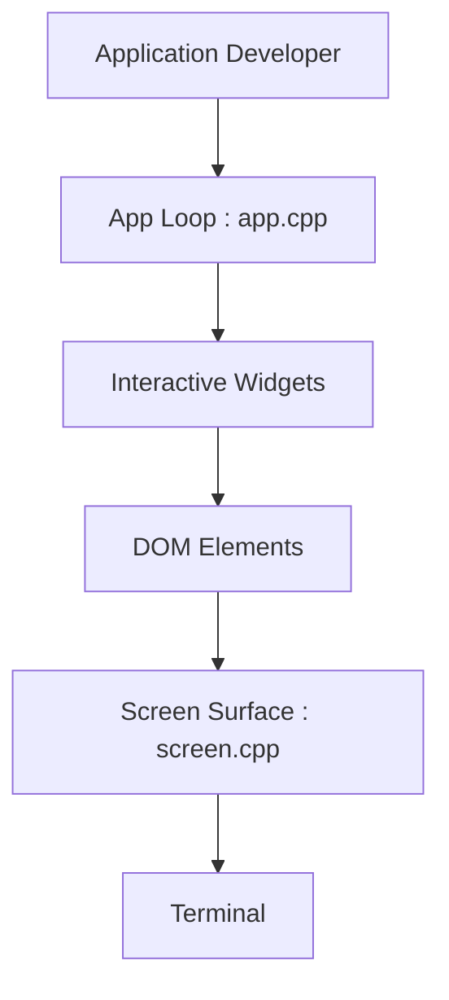

# ArthurSonzogni/FTXUI

> C++ library for terminal user interfaces, functional in style, dependency-free, cross-platform.

## The problem
Building a text interface in C++ without relying on old or heavy libraries.

## What it actually does
Three modules: `screen` (low-level rendering), `dom` (elements and layout: hbox, vbox, grid, flexbox, styles) and `component` (widgets, events, main loop). It handles UTF-8, mouse, animations and canvas drawing. A WebAssembly version exists.

## How it is wired


## Trying it
```bash
meson setup builddir
ninja -C builddir
```
With CMake, the README recommends `FetchContent` on the v7.0.3 tag.

## Cost and gotchas
Free, MIT license. Link order must be respected: `-lftxui-component -lftxui-dom -lftxui-screen`. Requires a recent C++ compiler for the C++20 modules.

## What it is not
It is not a Python library, nor a desktop graphical framework. The author also points to another experimental project, RTXUI.

## Alternatives
- RTXUI: another library by the author, experimental, based on HTML and CSS.

## For you
Ignore: a C++ tool for text interfaces, outside the Python data, AI or MLOps scope.
