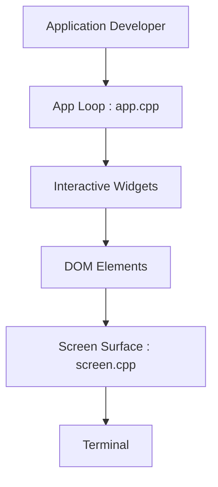

# ArthurSonzogni/FTXUI

> Bibliothèque C++ d'interfaces en terminal, de style fonctionnel, sans dépendances, multiplateforme.

## Le problème
Construire une interface texte en C++ sans passer par des bibliothèques anciennes ou lourdes.

## Ce que ça fait vraiment
Trois modules : `screen` (rendu bas niveau), `dom` (éléments et mise en page : hbox, vbox, grille, flexbox, styles) et `component` (widgets, événements, boucle principale). Elle gère UTF-8, souris, animations et dessin sur canevas. Une version WebAssembly existe.

## Comment c'est branché


## Essayer
```bash
meson setup builddir
ninja -C builddir
```
Avec CMake, le README recommande `FetchContent` sur la balise v7.0.3.

## Coût et pièges
Gratuit, licence MIT. Ordre de liens à respecter : `-lftxui-component -lftxui-dom -lftxui-screen`. Nécessite un compilateur C++ récent pour les modules C++20.

## Ce que ce n'est pas
Ce n'est pas une bibliothèque Python, ni un cadre graphique de bureau. L'auteur signale aussi un autre projet expérimental, RTXUI.

## Alternatives
- RTXUI : autre bibliothèque de l'auteur, expérimentale, fondée sur HTML et CSS.

## Pour toi
Ignorer : outil C++ pour interfaces texte, hors périmètre data, IA ou MLOps en Python.

