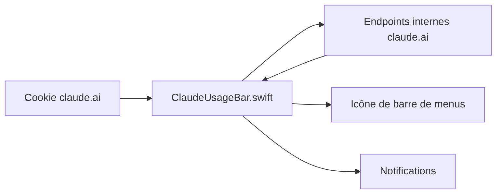

# Artzainnn/ClaudeUsageBar

> macOS menu bar app that shows your Claude.ai usage limits in real time.

## The problem
Claude.ai's 5-hour session and weekly limits are only visible on a settings page.

## What it actually does
A Swift/SwiftUI app reads claude.ai's internal endpoints with a cookie that you copy yourself from the browser's developer tools. It shows session and weekly usage through a colored icon, notifies at 25, 50, 75 and 90 percent, refreshes every 5 minutes and opens with Cmd+U. Data stays local.

## How it is wired
Simplified diagram based on the fiche, no diagram provided.


## Trying it
```bash
cd app
chmod +x build.sh
./build.sh

./create_dmg.sh
```

## Cost and gotchas
Free, but you need a Claude.ai account and must paste a session cookie by hand. macOS 12 minimum. The README states that these internal endpoints may change without notice.

## What it is not
Not an Anthropic product: the README says so. It only works on Mac. The cookie gives access to your account: handle it with care.

## Alternatives
No alternative named in the README.

## For you
Worth watching: handy for tracking your Claude quotas on Mac, but it relies on an undocumented API and a session cookie.
