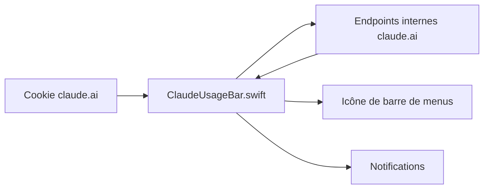

# Artzainnn/ClaudeUsageBar

> Application macOS dans la barre de menus qui affiche tes limites d'usage Claude.ai en temps réel.

## Le problème
Les limites de session de 5 heures et hebdomadaires de Claude.ai ne sont visibles que sur une page de réglages.

## Ce que ça fait vraiment
Une app Swift/SwiftUI lit les points d'accès internes de claude.ai avec un cookie que tu copies toi-même depuis les outils de développement du navigateur. Elle affiche l'usage de session et hebdomadaire par une icône colorée, notifie à 25, 50, 75 et 90 pour cent, se rafraîchit toutes les 5 minutes et s'ouvre avec Cmd+U. Les données restent en local.

## Comment c'est branché
Schéma simplifié d'après la fiche, sans diagramme fourni.


## Essayer
```bash
cd app
chmod +x build.sh
./build.sh

./create_dmg.sh
```

## Coût et pièges
Gratuit, mais il faut un compte Claude.ai et coller un cookie de session à la main. macOS 12 minimum. Le README précise que ces endpoints internes peuvent changer sans préavis.

## Ce que ce n'est pas
Pas un produit Anthropic : le README le dit. Il ne marche que sur Mac. Le cookie donne accès à ton compte : à manipuler avec prudence.

## Alternatives
Aucune alternative nommée dans le README.

## Pour toi
À surveiller : pratique pour suivre tes quotas Claude sur Mac, mais il repose sur une API non documentée et sur un cookie de session.

