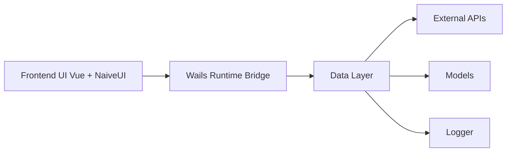

# ArvinLovegood/go-stock

> Desktop stock analysis application (A/HK/US shares) driven by LLMs, in Chinese.

## The problem
Following Chinese prices, news and technical signals means juggling several financial sites.

## What it actually does
Wails application (Go + Vue/NaiveUI): quotes, K-lines with many indicators, capital flows, funds and ETFs.
AI agents (React / PlanExecute / DeepAgents), more than 150 data tools, MCP, skills, vision.
Backtesting of prompts and recommendations, daily review, Feishu/DingTalk alerts.
Compatible with OpenAI, Ollama, DeepSeek and many Chinese providers.

## How it is wired

## Trying it
No documented command: only binaries to download (Windows, macOS).

## Cost and gotchas
LLM key at your own expense; some features (synced news) are reserved for paying VIP subscribers. Developed mostly for Windows.

## What it is not
Not investment advice: the README says "for entertainment". Nothing is tested outside Windows.

## Alternatives
No alternative named in the README.

## For you
Ignore: a consumer tool centered on the Chinese market, with a freemium model, of no value for a data or ML pipeline.
