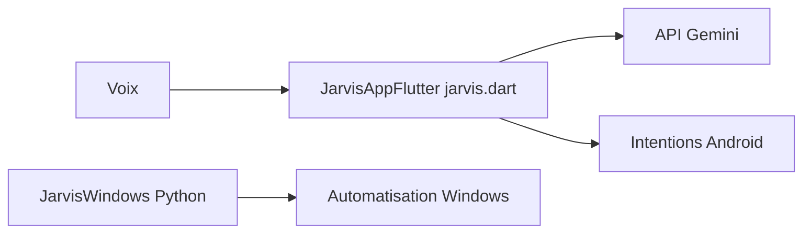

# Aryan-0001/Jarvis-AI

> Collection of experimental voice assistants inspired by JARVIS, for Android (Flutter) and Windows (Python).

## The problem
The README does not describe a specific problem: it is a hobby project trying to reproduce a voice assistant.

## What it actually does
Three parts: an Android Flutter app (voice, Gemini, Android intents), a Windows Python script (voice commands, desktop automation) and a vision prototype. The Android source is a single Dart file, not a full Flutter project. The APK is under maintenance.

## How it is wired
Simplified diagram based on the sheet, no diagram provided.

## Trying it
No command documented in this README: it points to separate installation guides.

## Cost and gotchas
A Gemini API key must be supplied, hard-coded in the source: it can be extracted from an APK. The README asks you to review the automation scripts before running them.

## What it is not
Not a finished application nor a Flutter project ready to build. No build or device test is claimed.

## Alternatives
No alternative named in the README.

## For you
Ignore: incomplete hobby project, with a hard-coded API key, of no value for a data or MLOps profile.
