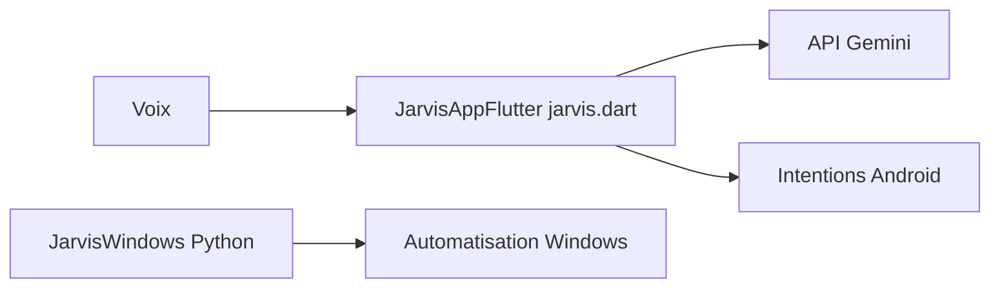

# Aryan-0001/Jarvis-AI

> Collection d'assistants vocaux expérimentaux inspirés de JARVIS, pour Android (Flutter) et Windows (Python).

## Le problème
Le README ne décrit pas un problème précis : c'est un projet de loisir qui cherche à reproduire un assistant vocal.

## Ce que ça fait vraiment
Trois volets : une appli Android Flutter (voix, Gemini, intentions Android), un script Windows en Python (commandes vocales, automatisation du bureau) et un prototype de vision. La source Android est un fichier Dart unique, pas un projet Flutter complet. L'APK est en maintenance.

## Comment c'est branché
Schéma simplifié d'après la fiche, sans diagramme fourni.

## Essayer
Aucune commande documentée dans ce README : il renvoie à des guides d'installation séparés.

## Coût et pièges
Clé d'API Gemini à fournir, codée en dur dans le source : elle est extractible d'un APK. Le README demande de relire les scripts d'automatisation avant de les lancer.

## Ce que ce n'est pas
Pas une application aboutie ni un projet Flutter prêt à compiler. Aucun test de build ni d'appareil n'est revendiqué.

## Alternatives
Aucune alternative nommée dans le README.

## Pour toi
À ignorer : projet de loisir incomplet, avec une clé d'API en dur, sans valeur pour un profil data ou MLOps.

