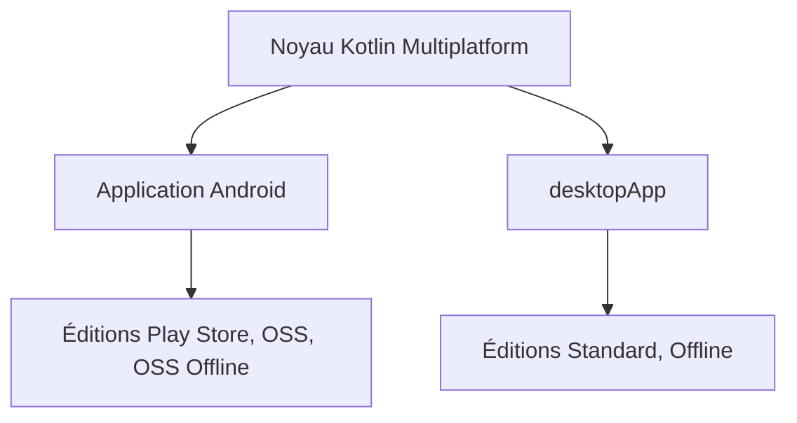

# Aryan-Raj3112/episteme

> Customizable document, e-book and comic reader for Android and desktop, local-first.

## The problem
Readers impose their formats, their typography and sometimes online services.

## What it actually does
Reads PDF, EPUB, MOBI/AZW3, FB2, DOCX, ODT, TXT, Markdown, HTML and comic archives, with paged or scrolled reading, PDF annotations, themes, local fonts and text-to-speech. Kotlin Multiplatform core and five editions: Play Store (OCR, cloud sync, AI), OSS, OSS offline, Standard and offline for desktop. AI goes through your own keys in the OSS edition.

## How it is wired
Simplified diagram based on the sheet, no diagram provided.


## Trying it
```bash
git clone https://github.com/Aryan-Raj3112/episteme.git
./gradlew assembleOssDebug
./gradlew :desktopApp:packageReleaseDistributionForCurrentOS
```

## Cost and gotchas
The OSS editions are free; the Play Store version includes proprietary extras. The AI and cloud features of the OSS edition require your own keys. Contributing translations requires accepting a contributor license agreement.

## What it is not
Not a 100% open reader: the Play Store edition contains proprietary services. The README measures no performance.

## Alternatives
No alternative named in the README.

## For you
Ignore: an e-book reader, unrelated to data, AI or MLOps work.
