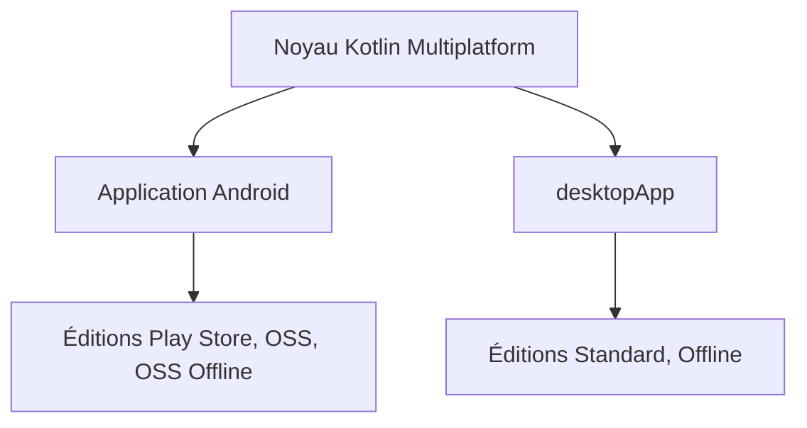

# Aryan-Raj3112/episteme

> Lecteur personnalisable de documents, e-books et bandes dessinées pour Android et ordinateur, en local d'abord.

## Le problème
Les lecteurs imposent leurs formats, leur typographie et parfois des services en ligne.

## Ce que ça fait vraiment
Lit PDF, EPUB, MOBI/AZW3, FB2, DOCX, ODT, TXT, Markdown, HTML et archives de bandes dessinées, avec lecture paginée ou défilée, annotations PDF, thèmes, polices locales et synthèse vocale. Noyau Kotlin Multiplatform et cinq éditions : Play Store (OCR, synchronisation cloud, IA), OSS, OSS hors ligne, Standard et hors ligne pour le bureau. L'IA passe par vos propres clés dans l'édition OSS.

## Comment c'est branché
Schéma simplifié d'après la fiche, sans diagramme fourni.


## Essayer
```bash
git clone https://github.com/Aryan-Raj3112/episteme.git
./gradlew assembleOssDebug
./gradlew :desktopApp:packageReleaseDistributionForCurrentOS
```

## Coût et pièges
Les éditions OSS sont gratuites ; la version Play Store inclut des extras propriétaires. Les fonctions IA et cloud de l'édition OSS demandent vos propres clés. Contribuer aux traductions exige d'accepter un accord de licence de contributeur.

## Ce que ce n'est pas
Pas un lecteur 100 % ouvert : l'édition Play Store contient des services propriétaires. Le README ne mesure aucune performance.

## Alternatives
Aucune alternative nommée dans le README.

## Pour toi
Ignorer : un lecteur d'e-books, sans lien avec un travail data, IA ou MLOps.

