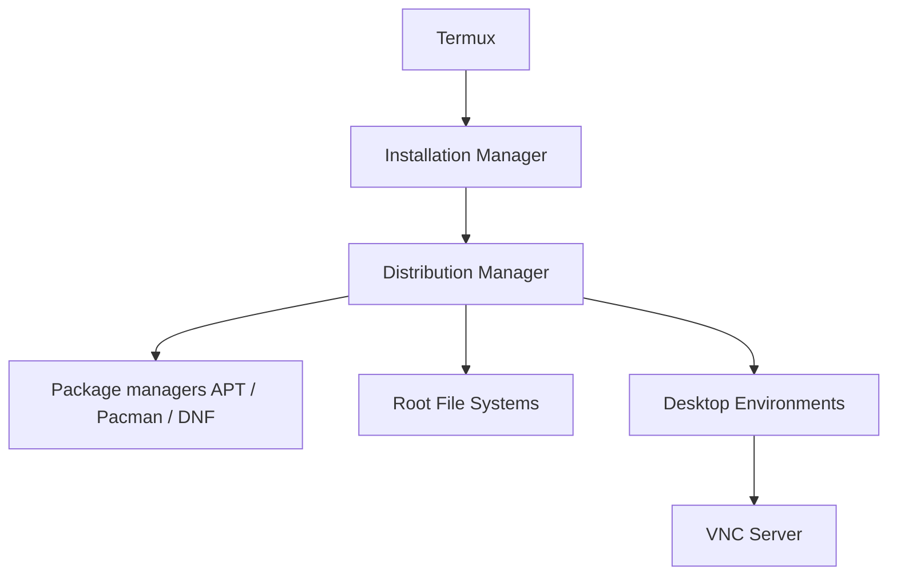

# AryanVBW/LinuxDroid

> Termux scripts that install Linux distributions (CLI and desktop) on Android without root.

## The problem
Running a real Linux with a desktop on an Android phone requires long manual steps in Termux.

## What it actually does
A menu installs Ubuntu, Debian, Kali, Arch, Alpine, Fedora, Parrot or NetHunter without root, with desktop environments (XFCE, LXDE, MATE) via VNC. The README also mentions security tools (Nmap, Metasploit, Burp Suite) installable in these distributions. Its architecture is a descriptive diagram and not derived from the code.

## How it is wired
Schema derived from the provided diagram, simplified.


## Trying it
```bash
pkg update -y && pkg upgrade -y
termux-setup-storage
pkg install wget -y && pkg install figlet -y
wget https://github.com/AryanVBW/LinuxDroid/releases/download/scripts/LinuxDroid.sh && chmod +x LinuxDroid.sh && bash LinuxDroid.sh
```

## Cost and gotchas
Free. The README suggests a `curl | bash` of a remote script, risky to run without reading it. Last push in October 2025. The project installs penetration-testing distributions, to be handled with care.

## What it is not
Not an emulator: it relies on proot in Termux. It is not itself an attack tool, but it makes installing them easier.

## Alternatives
No alternative named in the README.

## For you
Ignore: mobile curiosity, no use for data / AI / MLOps work, and a risky install script.
