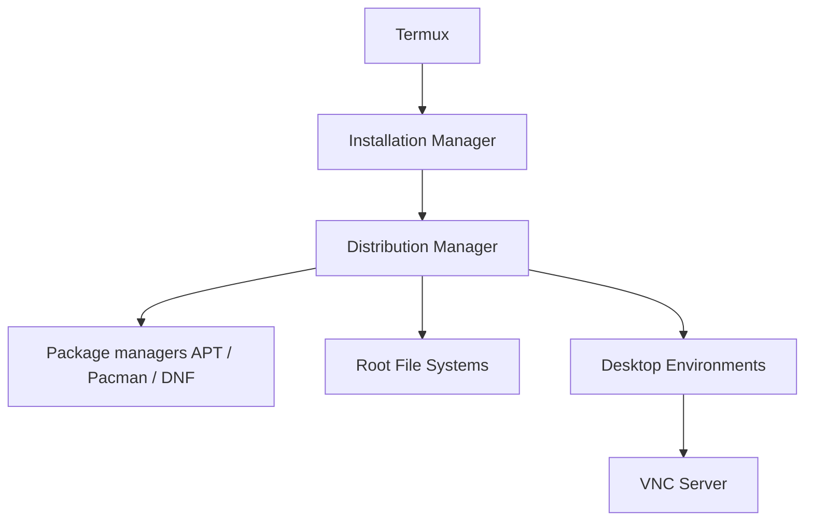

# AryanVBW/LinuxDroid

> Scripts Termux qui installent des distributions Linux (CLI et bureau) sur Android sans root.

## Le problème
Faire tourner un vrai Linux avec bureau sur un téléphone Android demande de longues manipulations dans Termux.

## Ce que ça fait vraiment
Un menu installe Ubuntu, Debian, Kali, Arch, Alpine, Fedora, Parrot ou NetHunter sans root, avec environnements de bureau (XFCE, LXDE, MATE) via VNC. Le README cite aussi des outils de sécurité (Nmap, Metasploit, Burp Suite) installables dans ces distributions. Son architecture est un schéma descriptif et non issu du code.

## Comment c'est branché
Schéma d'après le diagramme fourni, simplifié.


## Essayer
```bash
pkg update -y && pkg upgrade -y
termux-setup-storage
pkg install wget -y && pkg install figlet -y
wget https://github.com/AryanVBW/LinuxDroid/releases/download/scripts/LinuxDroid.sh && chmod +x LinuxDroid.sh && bash LinuxDroid.sh
```

## Coût et pièges
Gratuit. Le README propose un `curl | bash` d'un script distant, risqué à exécuter sans le lire. Dernier push en octobre 2025. Le projet installe des distributions de test d'intrusion, à manier avec prudence.

## Ce que ce n'est pas
Pas un émulateur : il s'appuie sur proot dans Termux. Ce n'est pas lui-même un outil d'attaque, mais il en facilite l'installation.

## Alternatives
Aucune alternative nommée dans le README.

## Pour toi
À ignorer : intérêt de curiosité mobile, sans utilité pour un travail data / IA / MLOps et script d'installation à risque.

