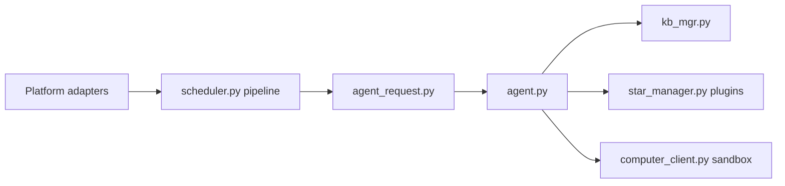

# AstrBotDevs/AstrBot

> Multi-messaging chatbot platform with plugins and a sandbox, designed for integrators.

## The problem
Deploying an LLM agent on QQ, Feishu, Telegram, or Slack requires significant technical expertise and infrastructure.

## What it actually does
Platform adapters inject messages into an event pipeline (pre-processing, agent request, response). Runtime agent with model providers, vector knowledge base, plugins (over 1000 announced), skills, MCP (Management Console Platform), and a code execution sandbox. WebUI for administration, SQLite database.

## How it is wired


## Trying it
```bash
uv tool install astrbot --python 3.12
astrbot init
astrbot run
```

## Cost and gotchas
LLM API key (or Dify, Coze, Bailian). AGPL-3.0: Restrictive if you expose it as a modified service. 1,523 open issues.

## What it is not
Not a library; an ecosystem centered around Chinese messaging services. The detailed wiring is not verified by the architecture.

## Alternatives
None are listed in the README.

## For you
Same time slot as CowAgent; only to be monitored for an internal bot on messaging platforms.
