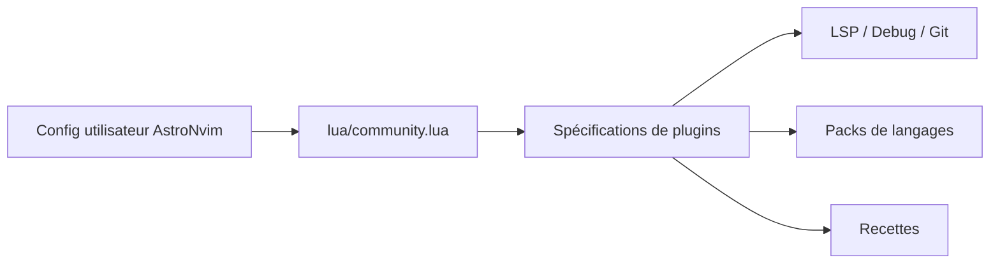

# AstroNvim/astrocommunity

> Community catalog of plugin specifications for AstroNvim, a Neovim configuration.

## The problem
Choosing and configuring dozens of Neovim plugins for AstroNvim by hand.

## What it actually does
Ready-to-import plugin specifications: completion, search, navigation, LSP, debugging, Git, language packs, themes, recipes. The user imports them before their own plugins (in `lua/community.lua`) so they can override them. Short README: the details of the plugins are not in it.

## How it is wired

## Trying it
No command documented in the README: add the specifications in `lua/community.lua` of the AstroNvim template.

## Cost and gotchas
Free. You must already use AstroNvim.

## What it is not
Not a standalone plugin nor a complete Neovim configuration.

## Alternatives
No alternative named in the README.

## For you
Worth watching: practical only if your editor is AstroNvim, with Python packs for data work.
