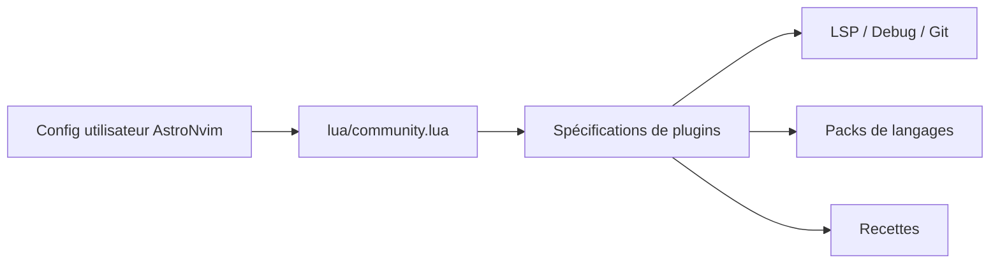

# AstroNvim/astrocommunity

> Catalogue communautaire de spécifications de plugins pour AstroNvim, configuration de Neovim.

## Le problème
Choisir et configurer à la main des dizaines de plugins Neovim pour AstroNvim.

## Ce que ça fait vraiment
Des spécifications de plugins prêtes à importer : complétion, recherche, navigation, LSP, débogage, Git, packs de langages, thèmes, recettes. L'utilisateur les importe avant ses propres plugins (dans `lua/community.lua`) pour pouvoir les surcharger. README court : le détail des plugins n'y figure pas.

## Comment c'est branché

## Essayer
Aucune commande documentée dans le README : ajouter les spécifications dans `lua/community.lua` du template AstroNvim.

## Coût et pièges
Gratuit. Il faut déjà utiliser AstroNvim.

## Ce que ce n'est pas
Pas un plugin autonome ni une configuration Neovim complète.

## Alternatives
Aucune alternative nommée dans le README.

## Pour toi
À surveiller : pratique seulement si ton éditeur est AstroNvim, avec packs Python pour travailler en data.

