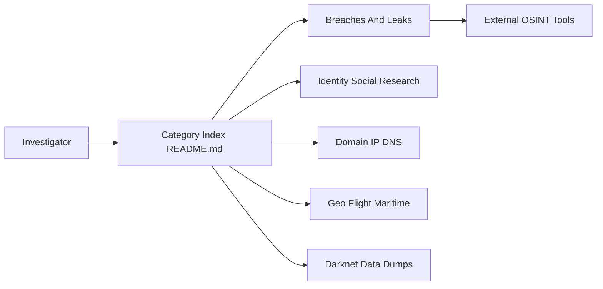

# Astrosp/Awesome-OSINT-List

> A single, very broad list of open-source intelligence sites and tools, for investigators and researchers.

## The problem
OSINT resources are scattered and their links die quickly. You need an index by theme to know where to look.

## What it actually does
- A single README organized by sections: data leaks, usernames, email, phone, social networks, domains/IP/DNS, malware, geo, flights and ships, public registries, darknet, cryptocurrencies, training.
- An AI and LLM security section (Garak, PyRIT, MITRE ATLAS) is also included.
- Mixes open source tools, free or paid online services, and training resources.
- Dead links are marked with strikethrough (404); no automatic verification is documented.

## How it is wired


## Trying it
Nothing to install: open the README and follow the links.

```bash
git clone https://github.com/Astrosp/Awesome-OSINT-List
```

## Cost and gotchas
Free, but many entries point to paid or sign-up services. Some sections (leaks, people search, social network scrapers) involve personal data: the legal framework (GDPR, consent, purpose) is up to the user.

## What it is not
Not a tool: no executable code. Entries are not assessed or sorted by reliability, and the text contains promotional descriptions. It mixes defensive and sensitive uses.

## Alternatives
- jivoi/awesome-osint: competing list cited in the Resources section.
- OSINT Framework: directory by categories cited in the README.
- Bellingcat's Online Investigation Toolkit: cited in the README.

## For you
Worth watching: useful as a starting directory for threat monitoring or source verification, but to be used with personal sorting and caution around personal data.
