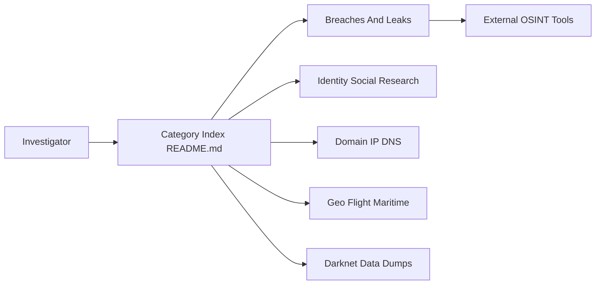

# Astrosp/Awesome-OSINT-List

> Liste unique, très large, de sites et outils de renseignement en sources ouvertes, pour enquêteurs et chercheurs.

## Le problème
Les ressources OSINT sont dispersées et leurs liens meurent vite. Il faut un index par thème pour savoir où chercher.

## Ce que ça fait vraiment
- Un README unique classé par rubriques : fuites de données, noms d'utilisateur, e-mail, téléphone, réseaux sociaux, domaines/IP/DNS, malwares, géo, vols et navires, registres publics, darknet, cryptomonnaies, formation.
- Une section IA et sécurité des LLM (Garak, PyRIT, MITRE ATLAS) y figure aussi.
- Mélange outils open source, services en ligne gratuits ou payants, et ressources de formation.
- Des liens morts sont marqués barrés (404) ; aucune vérification automatique documentée.

## Comment c'est branché


## Essayer
Rien à installer : on ouvre le README et on suit les liens.

```bash
git clone https://github.com/Astrosp/Awesome-OSINT-List
```

## Coût et pièges
Gratuit, mais beaucoup d'entrées pointent vers des services payants ou à inscription. Certaines rubriques (fuites, recherche de personnes, scrapers de réseaux sociaux) touchent à des données personnelles : le cadre légal (RGPD, consentement, finalité) revient à l'utilisateur.

## Ce que ce n'est pas
Ce n'est pas un outil : aucun code exécutable. Les entrées ne sont pas évaluées ni triées par fiabilité, et le texte contient des descriptions promotionnelles. Elle mêle usages défensifs et sensibles.

## Alternatives
- jivoi/awesome-osint : liste concurrente citée dans la section Resources.
- OSINT Framework : annuaire par catégories cité dans le README.
- Bellingcat's Online Investigation Toolkit : cité dans le README.

## Pour toi
Surveiller : utile comme annuaire de départ pour la veille menace ou la vérification de sources, mais à utiliser avec tri personnel et prudence sur les données personnelles.

