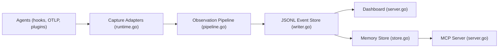

# Asymptote-Labs/agent-beacon

> Memory layer that captures the history of multi-tool coding agents and extracts reusable knowledge from it.

## The problem
What an agent learns in a session (a correction, a debugging lead, a convention) disappears at the end, and does not carry over from one tool to another.

## What it actually does
- Captures sessions, prompts, tool calls, commands, files, approvals, MCP and tokens from Claude Code, Cursor, Codex, OpenCode and 20+ others, normalized into OpenTelemetry events.
- Stores in local JSONL; read-only local dashboard, terminal trace browser.
- Evaluates the history, extracts reviewed knowledge then exposed through MCP or Agent Skills.
- Can forward to Splunk, Datadog, Elastic, S3, GCS… or to Beacon Cloud (opt-in).

## How it is wired


## Trying it
```bash
brew update && brew trust asymptote-labs/tap && brew tap asymptote-labs/tap
brew install beacon
beacon endpoint install
beacon traces
beacon endpoint dashboard
```

## Cost and gotchas
Free locally; Beacon Cloud pricing is not documented. The Cloud choice (preselected in the interactive install) transfers the traces: choose "Local" to keep everything at home. Traces contain prompts and commands, hence sensitive data.

## What it is not
Not an agent: it observes agents. The "lenses" are sandboxed HTML that does not block every possible leak: only install trusted lenses.

## Alternatives
No alternative named in the README.

## For you
Worth watching: the idea of a unified agent trace is useful in MLOps, but the project is five months old and the Cloud path calls for caution.
