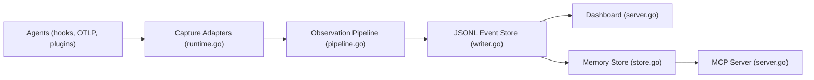

# Asymptote-Labs/agent-beacon

> Couche mémoire qui capture l'historique des agents de code multi-outils et en tire des connaissances réutilisables.

## Le problème
Ce qu'un agent apprend dans une session (correction, piste de debug, convention) disparaît à la fin, et ne passe pas d'un outil à l'autre.

## Ce que ça fait vraiment
- Capture sessions, prompts, appels d'outils, commandes, fichiers, approbations, MCP et tokens de Claude Code, Cursor, Codex, OpenCode et 20+ autres, normalisés en événements OpenTelemetry.
- Stocke en JSONL local ; dashboard local en lecture seule, navigateur de traces en terminal.
- Évalue l'historique, extrait des connaissances relues puis exposées via MCP ou Agent Skills.
- Peut transférer vers Splunk, Datadog, Elastic, S3, GCS… ou vers Beacon Cloud (opt-in).

## Comment c'est branché


## Essayer
```bash
brew update && brew trust asymptote-labs/tap && brew tap asymptote-labs/tap
brew install beacon
beacon endpoint install
beacon traces
beacon endpoint dashboard
```

## Coût et pièges
Gratuit en local ; la tarification de Beacon Cloud n'est pas documentée. Le choix Cloud (présélectionné à l'installation interactive) transfère les traces : choisir « Local » pour tout garder chez toi. Les traces contiennent prompts et commandes, donc données sensibles.

## Ce que ce n'est pas
Pas un agent : il observe les agents. Les « lenses » sont du HTML sandboxé qui ne bloque pas toutes les fuites possibles : n'installe que des lenses de confiance.

## Alternatives
Aucune alternative nommée dans le README.

## Pour toi
À surveiller : l'idée d'une trace unifiée des agents est utile en MLOps, mais le projet a cinq mois et la voie Cloud demande de la prudence.

