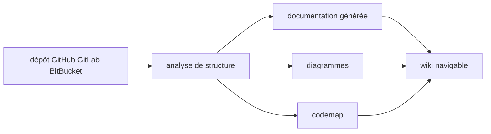

# AsyncFuncAI/deepwiki-open

> Automatically generates an interactive wiki and diagrams for a GitHub, GitLab or BitBucket repository.

## The problem
Arriving on an unfamiliar repository takes hours before you understand its structure and flows.
Documentation, when it exists, rarely describes the code as it is today.

## What it actually does
Five announced steps: code structure analysis, documentation generation, visual diagrams,
organization into a navigable wiki, and production of a "codemap" for guided code tours.
You just enter a repository name. The README is translated into ten languages.
Version 2.0 is announced under the name Grok Wiki, to be downloaded from an external site.

## How it is wired

## Trying it
No command documented in the README: it points to `https://grok-wiki.com`.

## Cost and gotchas
Nothing indicated: no model used, no API key, nor what runs locally versus on the hosted service.

## What it is not
Not an official reimplementation: the author presents it as their own attempt at implementing DeepWiki.
Not documented here as self-hostable software: the path put forward is an external download.
Not assessable as it stands: this README has fewer than 800 useful characters.

## Alternatives
None named in the README.

## For you
The idea is exactly your repository onboarding need — but nothing in this README lets you try it.
