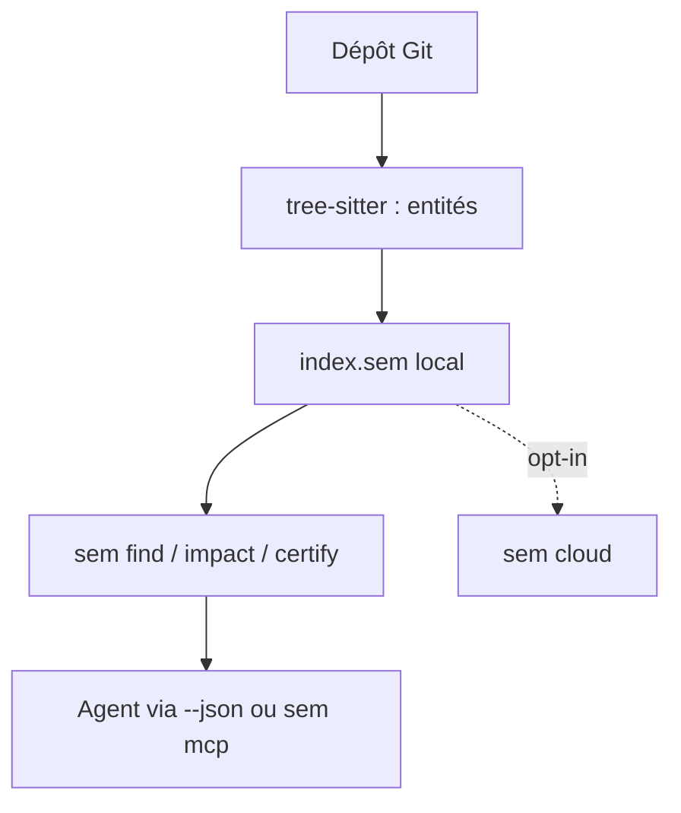

# Ataraxy-Labs/sem

> Git overlay that shows the functions, classes and methods changed rather than lines.

## The problem
A line-based diff does not say which entities change, who calls them or which tests to run, especially for an agent.

## What it actually does
It parses code with tree-sitter (32 languages) and diffs at the entity level. Verbs: `find`, `grep`, `impact`, `check`, `certify`, `diff`, `graph`, `history`. Each verb accepts `--json`, and `sem mcp` exposes them over MCP. Cloud mode is optional.

## How it is wired
Simplified diagram based on the fiche, no diagram provided.



## Trying it
```bash
curl -fsSL https://raw.githubusercontent.com/Ataraxy-Labs/sem/main/install.sh | sh
sem find parse_config --callers
sem impact parse_config --tests
sem certify main..HEAD
```

## Cost and gotchas
Free locally. The name `sem` conflicts with GNU Parallel. `sem config setup` modifies `git diff` and `~/.claude/settings.json` (with a backup). Telemetry is turned off with `sem config telemetry off`.

## What it is not
Not a replacement for Git: it builds on it. The cloud is an optional third-party service. README truncated after the list of languages.

## Alternatives
No alternative named in the README (weave, inspect and opensessions are projects by the same vendor).

## For you
Adopt: free, local, with JSON output and a Claude Code hook, it gives agents a view of impact and of tests to run.
