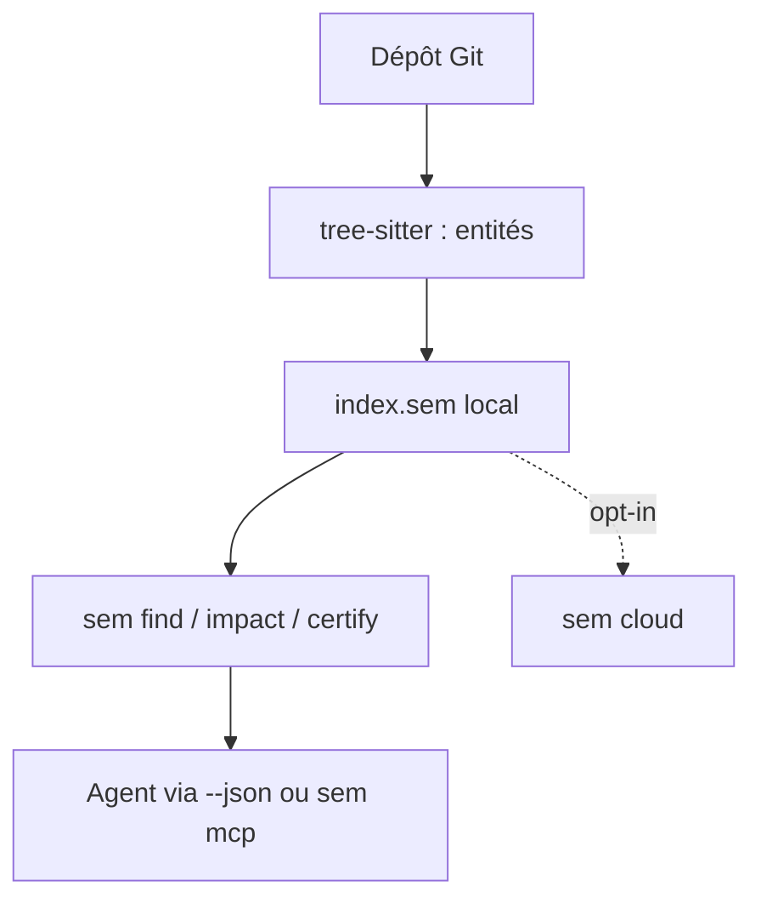

# Ataraxy-Labs/sem

> Surcouche de Git qui montre les fonctions, classes et méthodes modifiées plutôt que des lignes.

## Le problème
Un diff par lignes ne dit pas quelles entités changent, qui les appelle ni quels tests lancer, surtout pour un agent.

## Ce que ça fait vraiment
Il analyse le code avec tree-sitter (32 langages) et diffe au niveau des entités. Verbes : `find`, `grep`, `impact`, `check`, `certify`, `diff`, `graph`, `history`. Chaque verbe accepte `--json`, et `sem mcp` les expose en MCP. Le mode cloud est facultatif.

## Comment c'est branché
Schéma simplifié d'après la fiche, sans diagramme fourni.



## Essayer
```bash
curl -fsSL https://raw.githubusercontent.com/Ataraxy-Labs/sem/main/install.sh | sh
sem find parse_config --callers
sem impact parse_config --tests
sem certify main..HEAD
```

## Coût et pièges
Gratuit en local. Le nom `sem` entre en conflit avec GNU Parallel. `sem config setup` modifie `git diff` et `~/.claude/settings.json` (avec sauvegarde). La télémétrie se coupe par `sem config telemetry off`.

## Ce que ce n'est pas
Pas un remplaçant de Git : il s'appuie dessus. Le cloud est un service tiers facultatif. README tronqué après la liste des langages.

## Alternatives
Aucune alternative nommée dans le README (weave, inspect et opensessions sont des projets du même éditeur).

## Pour toi
À adopter : gratuit, local, avec sortie JSON et hook Claude Code, il donne aux agents une vue d'impact et de tests à lancer.

