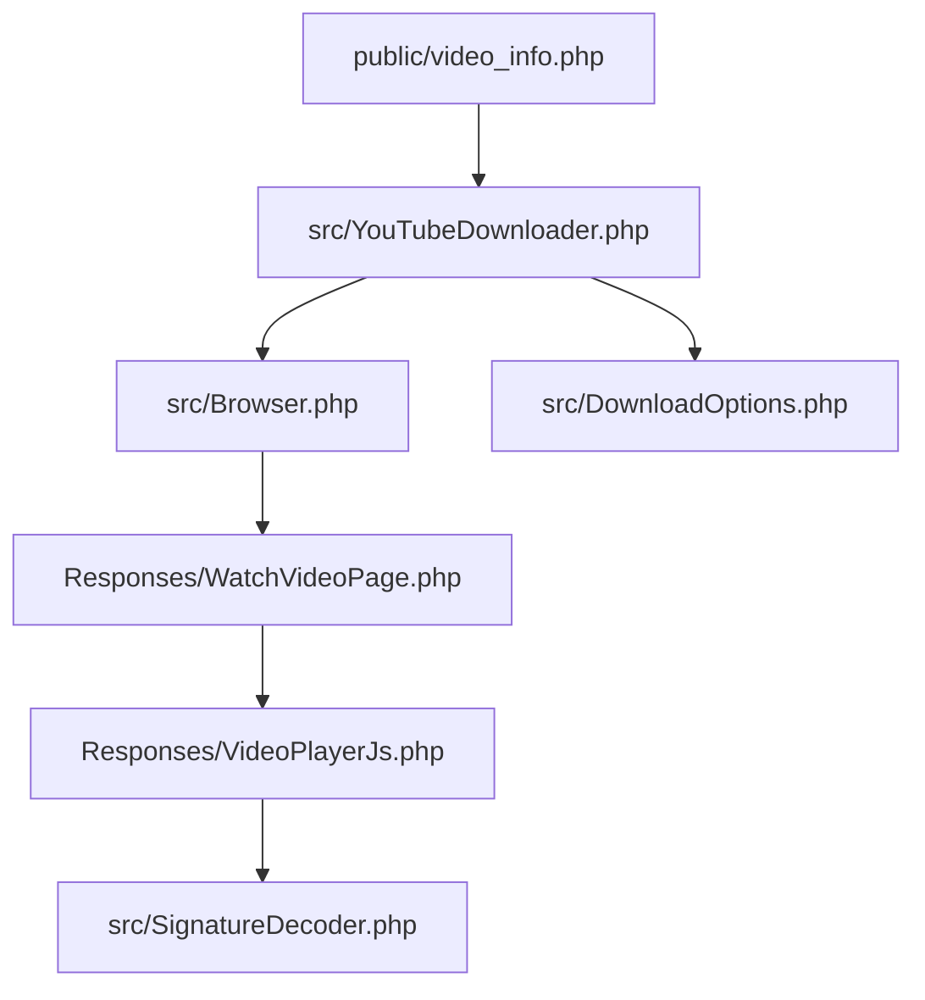

# Athlon1600/youtube-downloader

> Pure PHP library that retrieves download links for YouTube videos, for PHP developers.

## The problem
PHP tools for downloading YouTube videos are often abandoned or depend on youtube-dl. A PHP version was needed that requires neither a JS interpreter nor shell calls.

## What it actually does
`YouTubeDownloader` loads the page via `Browser`, decodes the signatures and returns a `DownloadOptions` object listing the streams (audio only or combined). `YouTubeStreamer` can stream a video from your server. Cookies and user-agent can be customized for age-restricted videos.

## How it is wired
Diagram based on the code diagram.


## Trying it
```bash
composer require athlon1600/youtube-downloader "^4.0"
```

## Cost and gotchas
Free. The README warns that downloading violates YouTube's terms. The to-do list mentions throughput limited to under 100 kB/s and unresolved HTTP 429 errors.

## What it is not
Not a full command-line tool, and no audio/video merging with ffmpeg (still to be done). It depends on the YouTube page, which keeps changing.

## Alternatives
- yt-dlp: the reference for downloading, cited in the README links.
- youtube-dl: the Python tool this project is inspired by.

## For you
Ignore: a PHP library that is fragile against YouTube changes; yt-dlp covers your possible need for video collection better.
