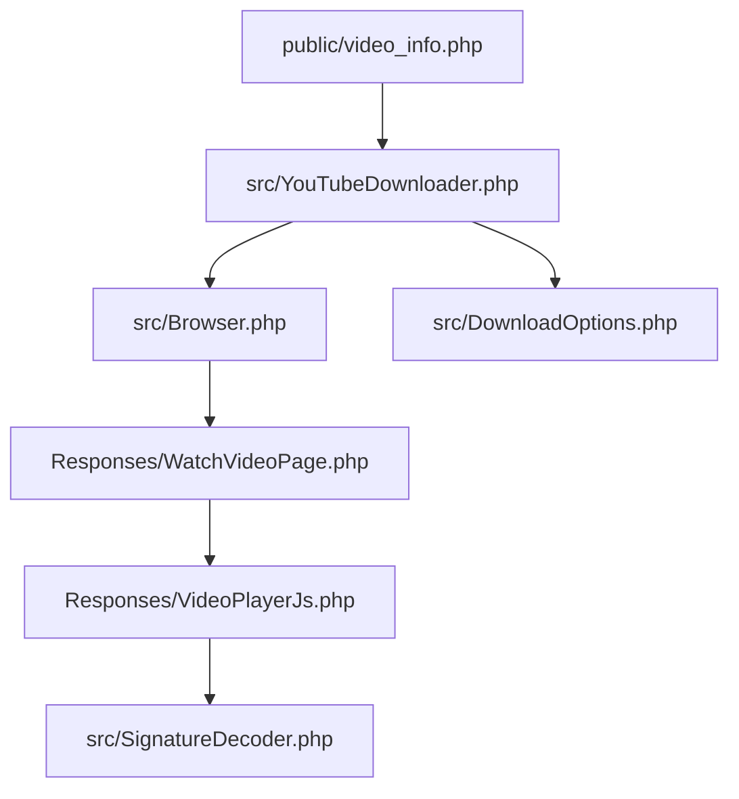

# Athlon1600/youtube-downloader

> Bibliothèque PHP pure qui récupère les liens de téléchargement de vidéos YouTube, pour développeurs PHP.

## Le problème
Les outils PHP de téléchargement YouTube sont souvent abandonnés ou dépendent de youtube-dl. Il fallait une version PHP sans interpréteur JS ni appel shell.

## Ce que ça fait vraiment
`YouTubeDownloader` charge la page via `Browser`, décode les signatures et renvoie un objet `DownloadOptions` listant les flux (audio seul ou combinés). `YouTubeStreamer` peut diffuser un flux depuis ton serveur. Cookies et user-agent sont personnalisables pour les vidéos à âge restreint.

## Comment c'est branché
Schéma d'après le diagramme du code.


## Essayer
```bash
composer require athlon1600/youtube-downloader "^4.0"
```

## Coût et pièges
Gratuit. Le README avertit que le téléchargement viole les conditions de YouTube. La liste de tâches cite le débit limité à moins de 100 ko/s et les erreurs HTTP 429 non résolus.

## Ce que ce n'est pas
Pas un outil en ligne de commande complet, et pas de fusion audio/vidéo avec ffmpeg (encore à faire). Le fonctionnement dépend de la page YouTube, qui change.

## Alternatives
- yt-dlp : référence pour le téléchargement, cité dans les liens du README.
- youtube-dl : l'outil Python dont ce projet s'inspire.

## Pour toi
À ignorer : bibliothèque PHP fragile face aux changements de YouTube, yt-dlp couvre mieux ton besoin éventuel de collecte de vidéos.

