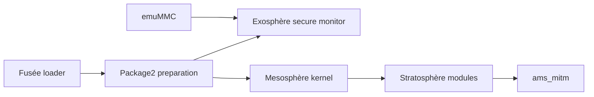

# Atmosphere-NX/Atmosphere

> Custom firmware for the Nintendo Switch, under development.

## The problem
Modifying the console's system requires replacing every boot layer, from the kernel to the system modules.

## What it actually does
Replaces or extends the whole chain: Fusée (first-stage loader), Exosphère (custom TrustZone), Mesosphère (ARM64 kernel), Stratosphère (system modules, including `ams_mitm` which intercepts services), Thermosphère/emuMMC (NAND virtualization), Troposphère (applications). Built with Make and packaged for an SD card.

## How it is wired

## Trying it
No command in the README: components and credits only.

## Cost and gotchas
Nintendo Switch console required; devkitA64/libnx toolchain to build. Risks tied to the hardware and the console's terms of use, not covered in the README.

## What it is not
Not a data/AI tool; the README announces work in progress.

## Alternatives
None named in the README.

## For you
Ignore: console firmware, unrelated to data / AI / MLOps.
