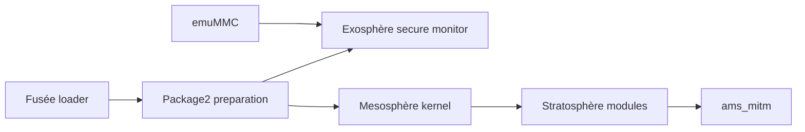

# Atmosphere-NX/Atmosphere

> Micrologiciel personnalisé pour la Nintendo Switch, en cours de développement.

## Le problème
Modifier le système de la console demande de remplacer chaque couche de démarrage, du noyau aux modules système.

## Ce que ça fait vraiment
Remplace ou étend toute la chaîne : Fusée (chargeur de premier niveau), Exosphère (TrustZone personnalisée), Mesosphère (noyau ARM64), Stratosphère (modules système, dont `ams_mitm` qui intercepte les services), Thermosphère/emuMMC (virtualisation de la NAND), Troposphère (applications). Construit avec Make et empaqueté pour une carte SD.

## Comment c'est branché

## Essayer
Aucune commande dans le README : composants et crédits uniquement.

## Coût et pièges
Console Nintendo Switch requise ; chaîne devkitA64/libnx pour compiler. Risques liés au matériel et aux conditions d'usage de la console, non traités dans le README.

## Ce que ce n'est pas
Pas un outil data/IA ; le README annonce un travail en cours.

## Alternatives
Aucune nommée dans le README.

## Pour toi
Ignorer : micrologiciel de console, sans rapport avec data / IA / MLOps.

