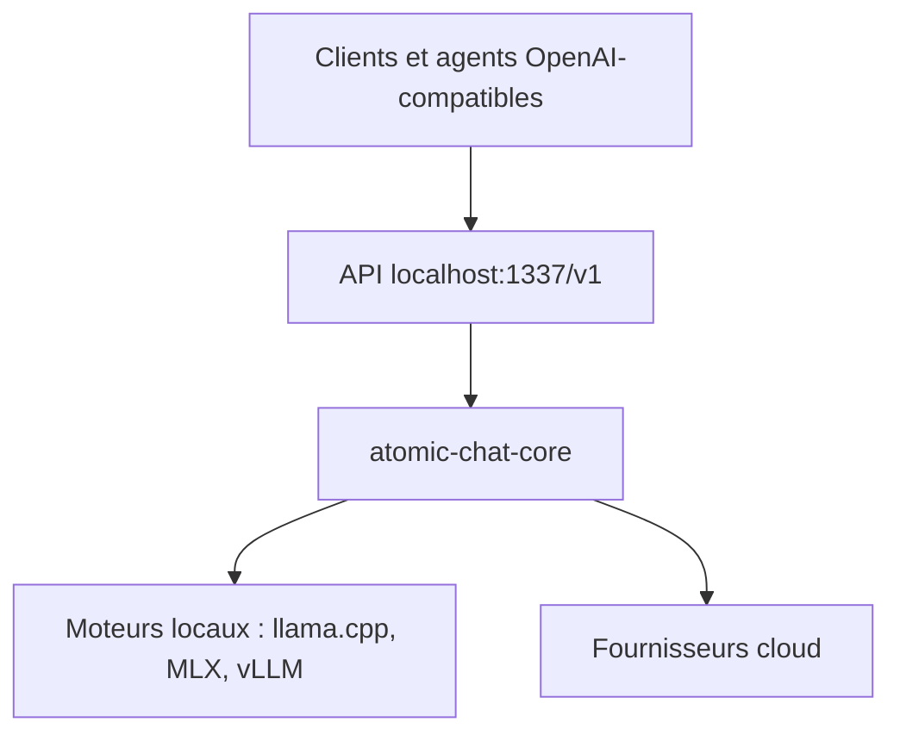

# AtomicBot-ai/Atomic-Chat

> Local LLM app with multiple inference engines and an OpenAI-compatible server, forked from Jan.

## The problem
Running open models locally requires choosing an engine per machine and reconfiguring each client.

## What it actually does
Twelve engines (llama.cpp, MLX-VLM, vLLM, SGLang, TensorRT-LLM, Foundry Local...) are exposed through a single server at `localhost:1337/v1`. The app downloads Hugging Face models, handles speculative decoding (MTP, DFlash, EAGLE-3) and TurboQuant KV cache, and plugs in cloud providers with your key. It launches agents such as Claude Code or OpenCode in one click, and connects to MCP servers.

## How it is wired
Simplified diagram based on the sheet, no diagram provided.


## Trying it
```bash
git clone https://github.com/AtomicBot-ai/Atomic-Chat
cd Atomic-Chat
make dev
curl http://localhost:1337/v1/chat/completions -H "Content-Type: application/json" -d '{"model": "<model-id-loaded-in-atomic-chat>", "messages": [{"role": "user", "content": "Say hello in one word"}]}'
```

## Cost and gotchas
Free locally; 8 GB of RAM for 3B models, 16 GB for 7B. The vLLM, SGLang and TensorRT-LLM engines require an NVIDIA GPU and a managed container. The license is not identified by GitHub.

## What it is not
Not an inference engine itself: the core orchestrates third-party engines. Only GGUF models run on Linux. The announced speed gains come from the author.

## Alternatives
- Jan: the original repository of the fork, cited in the README.
- OpenCode, Goose, Kilo Code: agents that can be plugged into the server, not direct alternatives.

## For you
Worth watching: a single local gateway for testing several engines is useful in MLOps, but the unclear license and young repository (March 2026).
