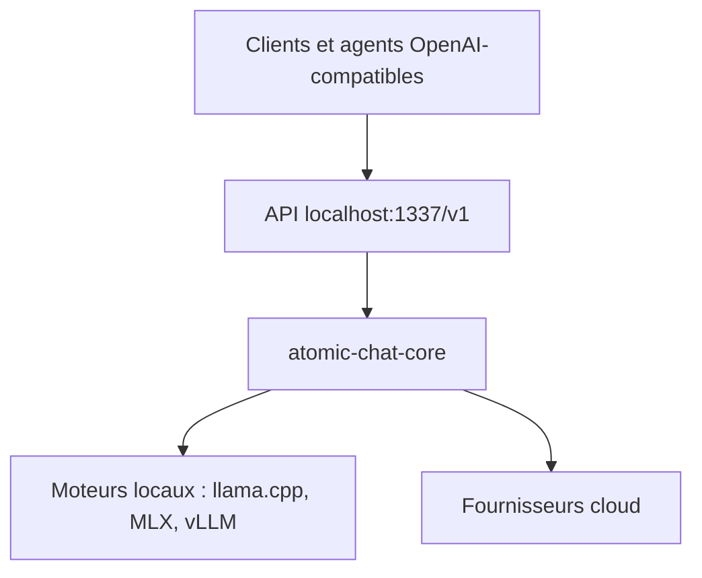

# AtomicBot-ai/Atomic-Chat

> Appli locale de LLM avec moteurs d'inférence multiples et serveur compatible OpenAI, issue d'un fork de Jan.

## Le problème
Faire tourner des modèles ouverts en local exige de choisir un moteur par machine et de reconfigurer chaque client.

## Ce que ça fait vraiment
Douze moteurs (llama.cpp, MLX-VLM, vLLM, SGLang, TensorRT-LLM, Foundry Local...) sont exposés par un unique serveur sur `localhost:1337/v1`. L'appli télécharge les modèles Hugging Face, gère décodage spéculatif (MTP, DFlash, EAGLE-3) et cache KV TurboQuant, et branche des fournisseurs cloud avec ta clé. Elle lance en un clic des agents comme Claude Code ou OpenCode, et se connecte à des serveurs MCP.

## Comment c'est branché
Schéma simplifié d'après la fiche, sans diagramme fourni.


## Essayer
```bash
git clone https://github.com/AtomicBot-ai/Atomic-Chat
cd Atomic-Chat
make dev
curl http://localhost:1337/v1/chat/completions -H "Content-Type: application/json" -d '{"model": "<model-id-loaded-in-atomic-chat>", "messages": [{"role": "user", "content": "Say hello in one word"}]}'
```

## Coût et pièges
Gratuit en local ; 8 Go de RAM pour des modèles 3B, 16 Go pour 7B. Les moteurs vLLM, SGLang et TensorRT-LLM demandent un GPU NVIDIA et un conteneur géré. La licence n'est pas identifiée par GitHub.

## Ce que ce n'est pas
Pas un moteur d'inférence lui-même : le coeur orchestre des moteurs tiers. Seuls les modèles GGUF tournent sous Linux. Les gains de vitesse annoncés viennent de l'auteur.

## Alternatives
- Jan : dépôt d'origine du fork, cité dans le README.
- OpenCode, Goose, Kilo Code : agents branchables sur le serveur, pas des alternatives directes.

## Pour toi
À surveiller : une passerelle locale unique pour tester plusieurs moteurs est utile en MLOps, mais licence floue et dépôt jeune (mars 2026).

