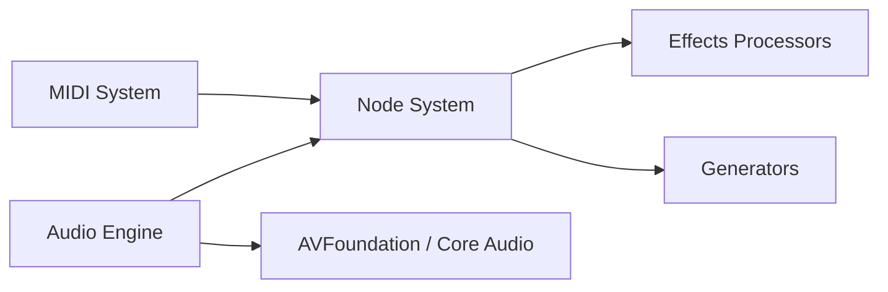

# AudioKit/AudioKit

> Audio synthesis, processing and analysis platform for iOS, macOS and tvOS developers.

## The problem
Building audio apps on Apple platforms requires mastering low-level APIs.

## What it actually does
A central audio engine connects nodes (effects, generators, playback, mixing), with MIDI, audio file handling and analysis "taps". According to the architecture described: it relies on AVFoundation and Core Audio.

## How it is wired

## Trying it
Install through Xcode: `File` → `Add Package Dependencies…`, then add the collection `https://swiftpackageindex.com/AudioKit/collection.json`. No shell command.

## Cost and gotchas
Free. Restricted to the Apple ecosystem and Xcode. The README asks for sponsorship.

## What it is not
Not an audio analysis tool for machine learning on the Python side: it is Swift for Apple apps.

## Alternatives
No alternative named in the README.

## For you
Ignore: targets Apple audio app development, unrelated to data/AI pipelines.
