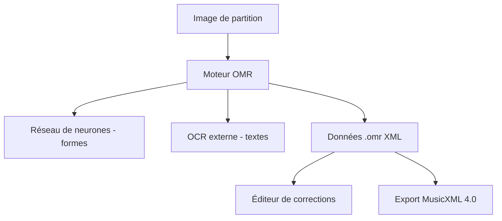

# Audiveris/audiveris

> Free optical music recognition software for sheet music, which exports to MusicXML, with an editor for corrections.

## The problem
A scanned score is an image: it cannot be read, played, edited or searched without retyping it by hand.

## What it actually does
The engine combines several techniques depending on the element: dedicated methods for staff lines, morphological closing for beams, external OCR for text, template matching for note heads and a neural network for other shapes. The editor is used to fix the remaining errors. Data is published as `.omr` (XML) or through the Java API, and export goes to MusicXML 4.0. It handles scores of hundreds of pages.

## How it is wired
Simplified diagram based on the sheet, no diagram provided.

## Trying it
No usage command: `.msi`, `.deb` or `.dmg` installer from the Releases (JRE included), or `winget`, `scoop`, `flatpak`. To build you need `git`, `gradle` and a JDK.

## Cost and gotchas
Free. AGPL-3.0 license: restrictive for a network service. The README warns against the fake sites audiveris.com and audiveris.net. Perfect recognition is out of reach: manual correction is built in.

## What it is not
Not a general text OCR nor a modern online AI tool: recognition is hybrid and comes with manual touch-ups. Only a subset of the data is exported to MusicXML.

## Alternatives
No alternative named in the README.

## For you
Worth watching: a mature example of hybrid vision (rules, templates, network) useful as a reference, but a narrow musical domain and an AGPL license to check before any service.
