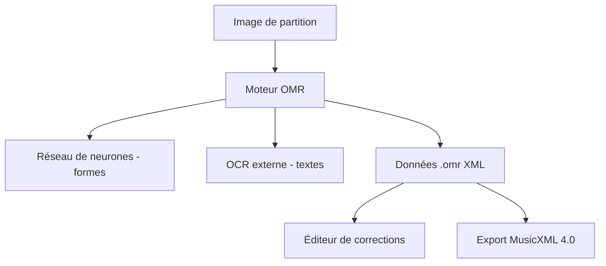

# Audiveris/audiveris

> Logiciel libre de reconnaissance optique de partitions musicales, qui exporte en MusicXML, avec éditeur de corrections.

## Le problème
Une partition scannée est une image : impossible de la lire, la jouer, l'éditer ou la chercher sans la ressaisir à la main.

## Ce que ça fait vraiment
Le moteur combine plusieurs techniques selon l'élément : méthodes dédiées pour les lignes, fermeture morphologique pour les barres, OCR externe pour les textes, correspondance de gabarits pour les têtes de notes et réseau de neurones pour les autres formes. L'éditeur sert à corriger les erreurs restantes. Les données sont publiées en `.omr` (XML) ou via l'API Java, et l'export va vers MusicXML 4.0. Il gère des partitions de centaines de pages.

## Comment c'est branché
Schéma simplifié d'après la fiche, sans diagramme fourni.

## Essayer
Aucune commande d'utilisation : installeur `.msi`, `.deb` ou `.dmg` depuis les Releases (JRE inclus), ou `winget`, `scoop`, `flatpak`. Pour compiler il faut `git`, `gradle` et un JDK.

## Coût et pièges
Gratuit. Licence AGPL-3.0 : contraignante en cas de service réseau. Le README met en garde contre les faux sites audiveris.com et audiveris.net. Une reconnaissance parfaite est hors de portée : correction manuelle prévue.

## Ce que ce n'est pas
Ce n'est pas un OCR de texte général ni un outil d'IA moderne en ligne : la reconnaissance est hybride et s'accompagne de retouches. Seul un sous-ensemble des données est exporté en MusicXML.

## Alternatives
Aucune alternative nommée dans le README.

## Pour toi
À surveiller : exemple abouti de vision hybride (règles, gabarits, réseau) utile en référence, mais domaine musical étroit et licence AGPL à vérifier avant tout service.

