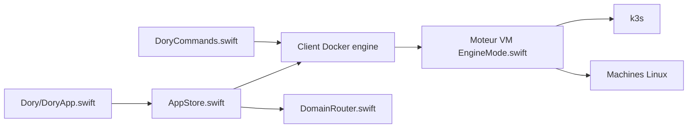

# Augani/dory

> Local runtime for Apple Silicon Macs: Docker, Kubernetes, Linux machines and sandboxes for agents.

## The problem
On a Mac, you have to combine Docker Desktop, a VM manager and a local cluster, with accounts, commercial licenses or telemetry.

## What it actually does
A SwiftUI app and a `dory` CLI that provide a shared Docker engine (Compose, Buildx), one-click k3s, separate Linux machines (Ubuntu, Debian, Kali desktops or headless Alpine), import from Docker Desktop, OrbStack, Colima or Podman, and VM sandboxes for agents. An MCP server (`dory mcp serve --read-only`) gives agents access to the engine state. Optional components are signed and installed on demand.

## How it is wired


## Trying it
```bash
brew install --cask Augani/dory/dory
docker context use dory
docker run --rm hello-world
dory doctor --active
dory sandbox run --json --network none --rollback -- /bin/sh -lc 'uname -a'
```

## Cost and gotchas
Free, with no account and no telemetry, but limited to Apple Silicon on macOS 14+, with 8 GiB of RAM recommended. Several features (Linux desktops, GPU, USB) are announced as not yet qualified for release.

## What it is not
Not a Linux or Intel tool. The README itself lists limits: no USB or audio passthrough, x86_64 ISOs rejected.

## Alternatives
OrbStack, Colima, Rancher Desktop or Podman (cited as migration sources).

## For you
Worth watching: interesting for a Mac MLOps development machine (Docker, k3s, sandboxes), but it is version 0.4, GPL-3.0 and has a single maintainer.
