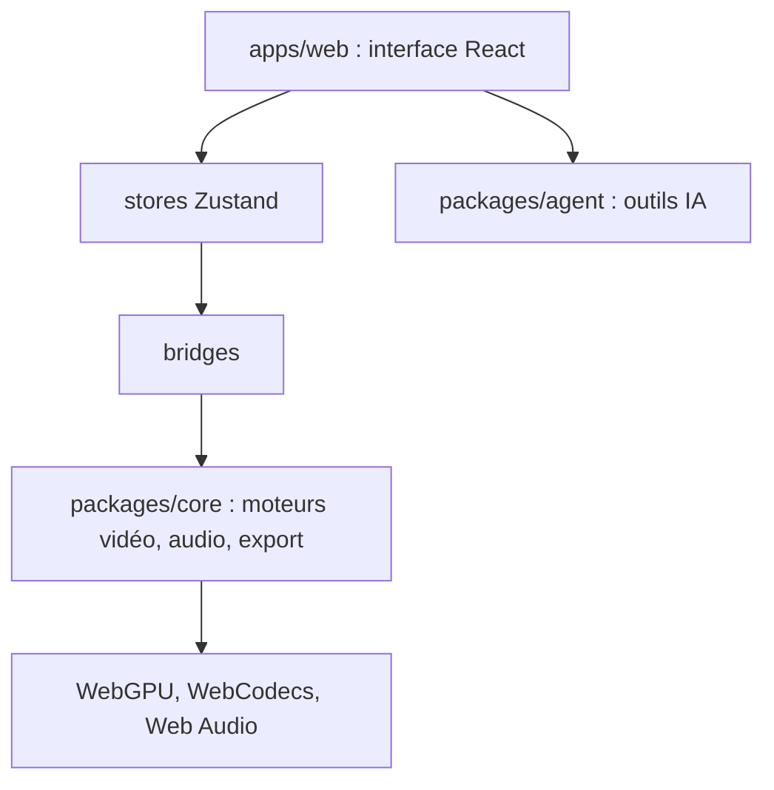

# Augani/openreel-video

> Open source video editor for browser and desktop, no watermark on export, with an optional AI assistant.

## The problem
Free video editors impose a watermark or upload your media to a server; you want to edit locally.

## What it actually does
Multitrack editing in the browser: cuts, subtitles, audio mixing, color grading, masks, keyframes, MP4 or WebM export up to 4K. Rendering happens on the device. An "AI Editor" panel drives the timeline by chat with a provider you connect (OpenAI, Anthropic or compatible). The desktop version (alpha) adds FFmpeg export and MCP access.

## How it is wired


## Trying it
```bash
git clone https://github.com/Augani/openreel-video.git
cd openreel-video
pnpm install
pnpm dev
pnpm build
pnpm preview
```

## Cost and gotchas
Free. The AI is optional and billed by your provider. Node and pnpm are only needed for local builds. Desktop builds are in alpha, codecs depend on the browser, and browser storage can be cleared: keep backups.

## What it is not
Not a generative video AI tool: the AI edits the timeline, it does not create images. Not a stable release on the desktop side.

## Alternatives
No alternative named in the README.

## For you
Worth watching: interesting for editing demos or tutorials without a watermark, but recent (January 2026) and run by a single person.
