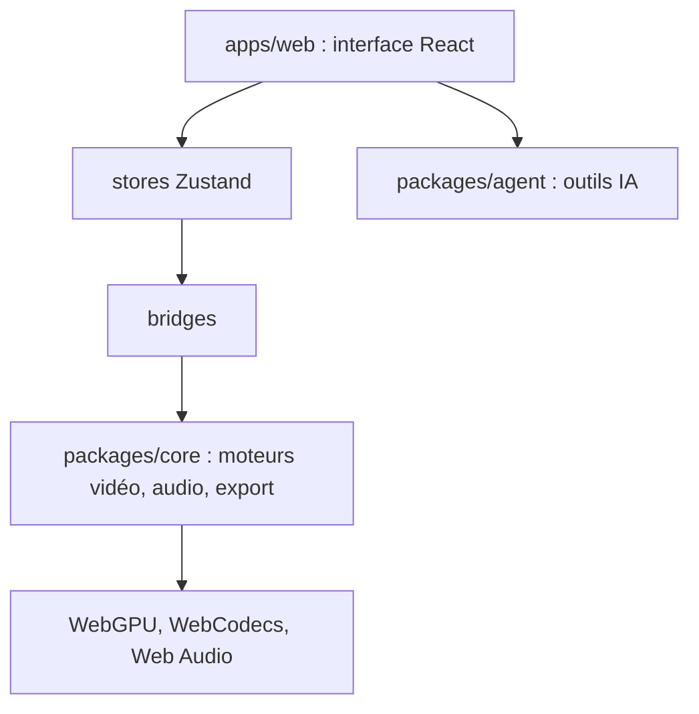

# Augani/openreel-video

> Éditeur vidéo open source pour navigateur et bureau, sans filigrane à l'export, avec assistant IA optionnel.

## Le problème
Les éditeurs vidéo gratuits imposent un filigrane ou envoient les médias sur un serveur ; on veut monter localement.

## Ce que ça fait vraiment
Un montage multipiste dans le navigateur : coupes, sous-titres, mixage audio, étalonnage, masques, keyframes, export MP4 ou WebM jusqu'en 4K. Le rendu se fait sur l'appareil. Un panneau « AI Editor » pilote la timeline par chat avec un fournisseur que tu connectes (OpenAI, Anthropic ou compatible). Le bureau (alpha) ajoute l'export FFmpeg et un accès MCP.

## Comment c'est branché


## Essayer
```bash
git clone https://github.com/Augani/openreel-video.git
cd openreel-video
pnpm install
pnpm dev
pnpm build
pnpm preview
```

## Coût et pièges
Gratuit. L'IA est optionnelle et facturée par ton fournisseur. Node et pnpm ne servent que pour la compilation locale. Les builds bureau sont en alpha, les codecs dépendent du navigateur, et le stockage navigateur peut être vidé : garde des sauvegardes.

## Ce que ce n'est pas
Ce n'est pas un outil d'IA générative vidéo : l'IA édite la timeline, elle ne crée pas d'images. Ce n'est pas une version stable côté bureau.

## Alternatives
Aucune alternative nommée dans le README.

## Pour toi
À surveiller : intéressant pour monter des démos ou des tutoriels sans filigrane, mais récent (janvier 2026) et porté par une seule personne.

